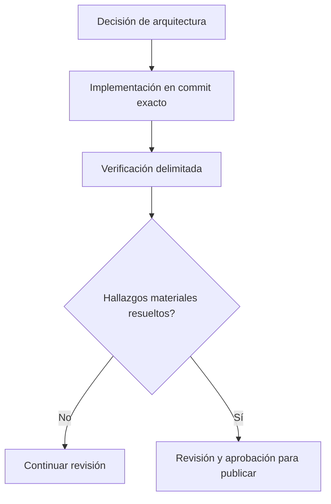

# De las decisiones de diseño a las evidencias de producción

*Borrador editorial. Publicación no aprobada.*

## El problema

Una revisión de arquitectura establece qué pretende garantizar un sistema. Una prueba unitaria muestra un comportamiento en un entorno controlado. Una prueba de integración con base de datos real demuestra más. Estar listo para producción exige otro nivel de evidencia. No son equivalentes.

## El límite

Usamos revisiones explícitas en la ingeniería de Sails: definir el invariante, implementar, probar concurrencia y reinicio cuando corresponda, inspeccionar la revisión exacta del código y registrar hallazgos pendientes. Una insignia verde de CI, por sí sola, no demuestra que un flujo económico sea seguro.

## Qué falta demostrar

El blog debería referenciar commits inmutables, pruebas relevantes, registros de decisiones y observaciones operativas verificadas. Una issue de hoja de ruta documenta intención; un cambio integrado documenta código; una ejecución de pruebas respalda una afirmación concreta. Nada de eso debe convertirse en una garantía más amplia sin justificación.

## Diagrama conceptual

Equivalente textual: el diagrama muestra los límites de responsabilidad descritos arriba, no un despliegue verificado.

*Referencias, revisión técnica y aprobación del responsable de publicación pendientes.*

## Escenario de fallo: pruebas verdes, recuperación insegura

Imaginemos una transición de operación que supera las pruebas unitarias y deja el CI en verde. Después, dos workers procesan el mismo evento de pago retrasado mientras una instancia se reinicia. Ambos pueden tener observaciones individualmente válidas, pero, si la comprobación de autoridad en la base de datos no es atómica, podrían producir resultados contradictorios. Una compilación correcta no demuestra que el límite de concurrencia y reinicio sea seguro.

La cadena de evidencia debe separar el invariante arquitectónico, el commit exacto de implementación, la prueba ejecutable y su entorno, el resultado observado y los hallazgos materiales todavía abiertos. Una prueba de carrera con PostgreSQL real refuerza una afirmación delimitada, pero no demuestra automáticamente el comportamiento de todos los workers, callbacks de proveedores y medios de liquidación en producción.

## Decisión, alternativa y prueba de lanzamiento

Un proceso de entrega más rápido podría aceptar solo CI unitario y revisar manualmente casos extremos. La alternativa más rigurosa exige pruebas de integración en el HEAD exacto, comprobaciones explícitas de autoridad e idempotencia, inyección de fallos, revisión independiente y un plan de verificación específico de producción. Esto requiere más tiempo, pero reduce el riesgo de convertir una suposición económica no probada en una promesa pública.

**Siguiente prueba:** repetir simultáneamente una observación retrasada de liquidación en dos workers, reiniciar uno durante la transición y comprobar que solo se registra una transición autorizada, manteniendo pendientes los resultados inciertos. Registrar código de prueba, versión de la base de datos, ejecución, commit exacto y decisión del revisor. Incluso una prueba delimitada aprobada no equivale a seguridad universal en producción.

## Límite examinado, no certificación de producción

Un principio arquitectónico no prueba un despliegue. **Fallo:** confundir diseño documentado con comportamiento desplegado. Faltan pruebas de integración y ejecución del HEAD exacto.

- [PROTOCOL_INVARIANTS.md](https://github.com/sails-protocol/Sails-Protocol/blob/be6d3bc2ddfc384cfafa4276e01b8aacc096d421/docs/PROTOCOL_INVARIANTS.md)
