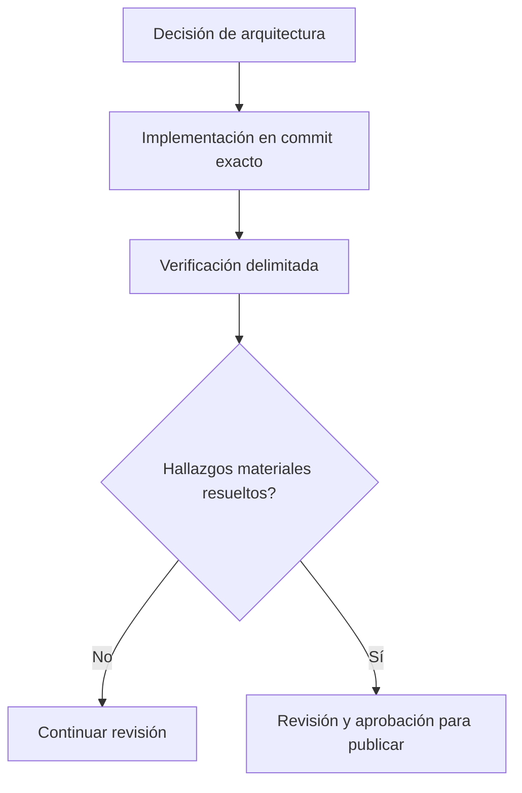

# De las decisiones de diseño a las evidencias de producción

*Borrador editorial. Publicación no aprobada.*

## El problema

Una revisión de arquitectura establece qué pretende garantizar un sistema. Una prueba unitaria muestra un comportamiento en un entorno controlado. Una prueba de integración con base de datos real demuestra más. Estar listo para producción exige otro nivel de evidencia. No son equivalentes.

## El límite

Usamos revisiones explícitas en la ingeniería de Sails: definir el invariante, implementar, probar concurrencia y reinicio cuando corresponda, inspeccionar la revisión exacta del código y registrar hallazgos pendientes. Una insignia verde de CI, por sí sola, no demuestra que un flujo económico sea seguro.

## Qué falta demostrar

El blog debería referenciar commits inmutables, pruebas relevantes, registros de decisiones y observaciones operativas verificadas. Una issue de hoja de ruta documenta intención; un cambio integrado documenta código; una ejecución de pruebas respalda una afirmación concreta. Nada de eso debe convertirse en una garantía más amplia sin justificación.

## Diagrama conceptual

Equivalente textual: el diagrama muestra los límites de responsabilidad descritos arriba, no un despliegue verificado.

*Referencias, revisión técnica y aprobación del responsable de publicación pendientes.*
