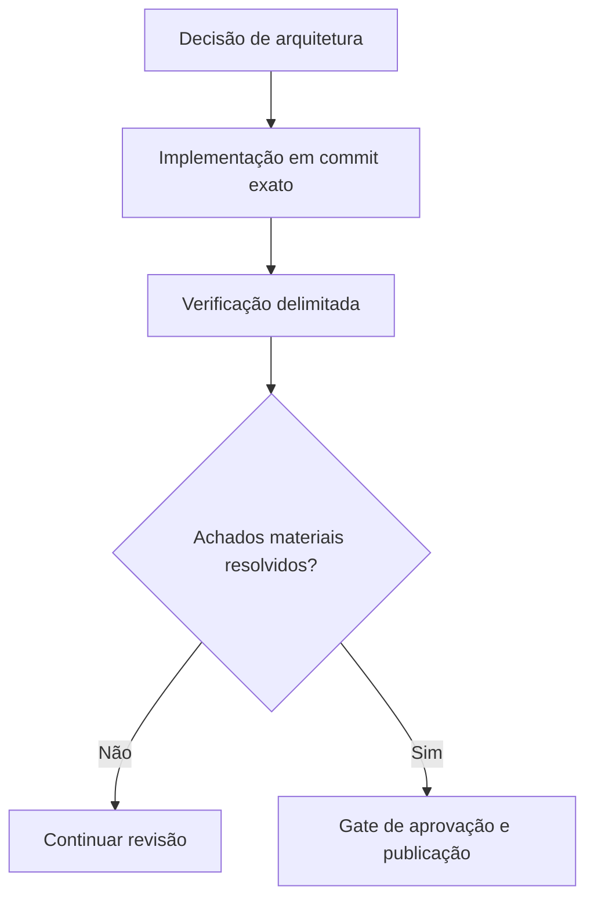

# Das decisões de arquitetura às evidências de produção

*Rascunho editorial. Publicação não aprovada.*

## O problema

Uma revisão de arquitetura estabelece o que um sistema pretende garantir. Um teste unitário mostra um comportamento em ambiente controlado. Um teste de integração com banco real demonstra mais. Prontidão para produção exige outro nível de evidência. Essas coisas não são intercambiáveis.

## O limite

Usamos gates explícitos nas revisões de engenharia do Sails: definir a invariável, implementar, testar concorrência e reinicialização quando necessário, inspecionar a revisão exata do código e registrar achados não resolvidos. Um selo verde de CI, sozinho, não prova que um fluxo econômico é seguro.

## O que ainda precisa ser comprovado

O blog deve referenciar fontes no nível de commits imutáveis, testes relevantes, registros de decisões e observações operacionais verificadas. Uma issue de roadmap documenta intenção; uma alteração integrada documenta código; uma execução de testes sustenta uma afirmação específica. Nada disso deve virar uma garantia mais ampla sem justificativa.

## Diagrama conceitual

Equivalente textual: o diagrama mostra os limites de responsabilidade descritos acima, não uma implantação verificada.

*Referências, revisão técnica e aprovação do responsável pela publicação pendentes.*

## Cenário de falha: testes verdes, recuperação insegura

Imagine uma transição de negociação que passa nos testes unitários e deixa o CI verde. Depois, dois workers processam o mesmo evento atrasado de pagamento enquanto uma instância reinicia. Ambos podem ter observações individualmente válidas, mas, se a verificação de autoridade no banco não for atômica, poderão produzir resultados conflitantes. Um build bem-sucedido não demonstra que o limite de concorrência e reinicialização é seguro.

A cadeia de evidências precisa separar a invariante arquitetural, o commit exato da implementação, o teste executável e seu ambiente, o resultado observado e os achados materiais ainda abertos. Um teste de corrida com PostgreSQL real fortalece uma afirmação delimitada, mas não comprova automaticamente o comportamento de todos os workers, callbacks de provedores e meios de liquidação em produção.

## Decisão, alternativa e teste de lançamento

Um processo de entrega mais rápido poderia aceitar apenas CI unitário e inspecionar manualmente casos extremos. A alternativa mais rigorosa exige testes de integração no HEAD exato, verificações explícitas de autoridade e idempotência, injeção de falhas, revisão independente e plano de validação específico de produção. Isso custa tempo, mas reduz o risco de transformar uma suposição econômica não testada em promessa pública.

**Próximo teste:** repetir simultaneamente uma observação atrasada de liquidação em dois workers, reiniciar um deles durante a transição e conferir se somente uma transição autorizada é registrada, mantendo resultados incertos como pendentes. Registrar código de teste, versão do banco, execução, commit exato e decisão do revisor. Mesmo um teste delimitado aprovado não equivale a segurança universal em produção.

## Fronteira examinada, não certificação de produção

Princípio arquitetural não é comprovação de implantação. **Falha:** confundir design documentado com comportamento implantado. Ainda são necessários testes de integração e execução no HEAD exato.

- [PROTOCOL_INVARIANTS.md](https://github.com/sails-protocol/Sails-Protocol/blob/be6d3bc2ddfc384cfafa4276e01b8aacc096d421/docs/PROTOCOL_INVARIANTS.md)
