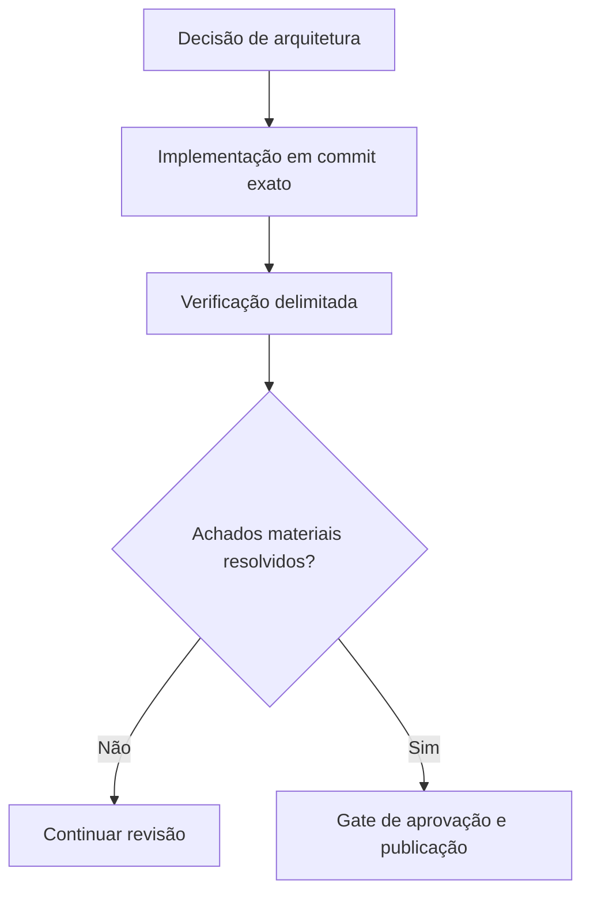

# Das decisões de arquitetura às evidências de produção

*Rascunho editorial. Publicação não aprovada.*

## O problema

Uma revisão de arquitetura estabelece o que um sistema pretende garantir. Um teste unitário mostra um comportamento em ambiente controlado. Um teste de integração com banco real demonstra mais. Prontidão para produção exige outro nível de evidência. Essas coisas não são intercambiáveis.

## O limite

Usamos gates explícitos nas revisões de engenharia do Sails: definir a invariável, implementar, testar concorrência e reinicialização quando necessário, inspecionar a revisão exata do código e registrar achados não resolvidos. Um selo verde de CI, sozinho, não prova que um fluxo econômico é seguro.

## O que ainda precisa ser comprovado

O blog deve referenciar fontes no nível de commits imutáveis, testes relevantes, registros de decisões e observações operacionais verificadas. Uma issue de roadmap documenta intenção; uma alteração integrada documenta código; uma execução de testes sustenta uma afirmação específica. Nada disso deve virar uma garantia mais ampla sem justificativa.

## Diagrama conceitual

Equivalente textual: o diagrama mostra os limites de responsabilidade descritos acima, não uma implantação verificada.

*Referências, revisão técnica e aprovação do responsável pela publicação pendentes.*
