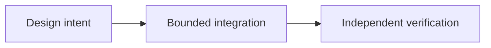

# Beyond P2P Trading: The Sails Protocol Vision

*Editorial draft. Season 4. Not approved for publication.*

## The question

What does a protocol become after its first SDK? A family of capabilities is useful only when its shared economic rules are explicit.

## Decision and boundary

The first focused integration is P2P Trading. Identity, proof, reputation, settlement, liquidity, agents and finance describe distinct modular directions, not one already deployed product. A new module must state which actor has authority, what economic effect it may request and which existing invariant it preserves. The protocol invariant document distinguishes architecture, implementation obligations and executable evidence.

## Failure and evidence

A wallet might integrate an OpenFinance feature and assume that the protocol guarantees its external lending provider. That would transfer responsibility without proof. Each provider needs a separate authority model, failure handling and acceptance gate; no roadmap item inherits production readiness from the Trading SDK.

## Next question

Which module can demonstrate a real, bounded integration with independently reproducible evidence?

## Conceptual flow

Text equivalent: the proposal progresses from design intent to a bounded integration and then to independent verification. This is not an implementation status report.

*Pending: source-of-truth verification, specific citations, editorial review and owner approval.*

## A concrete integration boundary: a lending offer is not a protocol guarantee

Imagine an application displaying a proposed loan from an external provider next to a P2P trade. The user sees one interface and assumes the same dispute rules, asset custody and recovery process govern both actions. If the loan provider changes its terms or becomes unavailable after the user authorizes a transfer, a coordination record cannot reverse the provider's external contract. The application must distinguish the actor requesting the action, the signer authorizing it, the provider responsible for execution and the source of final settlement truth.

One design option is to bundle every capability behind a unified service with shared branding and state. It simplifies the interface but risks hiding independent permissions, legal obligations and failure modes. A modular interface introduces explicit provider disclosures and separate confirmation steps, but makes authority and recovery boundaries auditable. An integration must never inherit a security claim solely because another module has passed its tests.

## Evidence and next verification

Before describing a future module as available, identify an exact source commit, implemented adapter and interface, supported networks, authorization checks, failure/retry tests and a provider-specific settlement observation. A roadmap entry, an architecture diagram or a green Trading SDK build is insufficient.

**Failure-injection test to propose:** accept an external provider's request, then delay its final settlement response while the app restarts and the user retries. Verify that the app preserves the pending state, does not duplicate economic intent and does not mislabel provider acceptance as protocol finality. No claim is made here that this test exists or passes. The pinned invariants are architectural context, not evidence of a deployed OpenFinance integration.

## Inspected boundary and failure

Future modules are roadmap concepts until separately implemented and verified. **Failure:** overstating design as verified deployment. The pinned source supports only the stated scope; runtime and CTO gates remain open.

- [PROTOCOL_INVARIANTS.md](https://github.com/sails-protocol/Sails-Protocol/blob/be6d3bc2ddfc384cfafa4276e01b8aacc096d421/docs/PROTOCOL_INVARIANTS.md)
