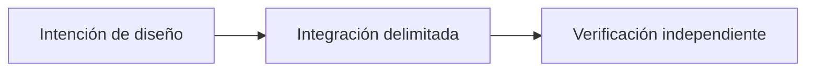

# Más allá del P2P Trading: la visión de Sails Protocol

*Borrador editorial. Temporada 4. Publicación no aprobada.*

## La cuestión

t

## Dirección de diseño

a

## Evidencia antes de las afirmaciones

a

## Flujo conceptual

Equivalente textual: la propuesta pasa de la intención de diseño a una integración delimitada y luego a la verificación independiente. No es un informe de implementación.

*Pendiente: verificación en fuentes técnicas, citas específicas, revisión editorial y aprobación del responsable.*

## Límite examinado y fallo

Los módulos futuros siguen en el roadmap hasta su implementación y verificación propias. **Fallo:** presentar diseño como despliegue verificado. La fuente fijada solo respalda este alcance; siguen pendientes los gates de ejecución y CTO.

- [PROTOCOL_INVARIANTS.md](https://github.com/sails-protocol/Sails-Protocol/blob/be6d3bc2ddfc384cfafa4276e01b8aacc096d421/docs/PROTOCOL_INVARIANTS.md)
