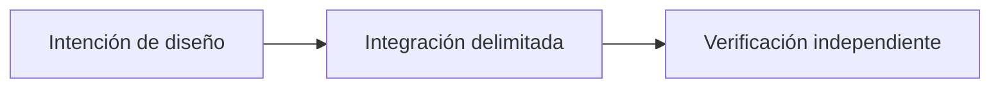

# Más allá del P2P Trading: la visión de Sails Protocol

*Borrador editorial. Temporada 4. Publicación no aprobada.*

## La pregunta

¿Qué viene después del primer SDK? Una familia de capacidades solo sirve si comparte reglas económicas explícitas.

## Decisión y límite

El primer foco es P2P Trading. Identidad, pruebas, reputación, liquidación, liquidez, agentes y finanzas son direcciones modulares distintas, no un producto ya desplegado. Cada módulo debe declarar quién tiene autoridad, qué efecto económico puede solicitar y qué invariante conserva. El documento de invariantes distingue arquitectura, obligaciones de implementación y evidencia ejecutable.

## Fallo y evidencia

Una billetera puede integrar una función OpenFinance y asumir que el protocolo garantiza a su proveedor externo de préstamos. Eso trasladaría responsabilidad sin prueba. Cada proveedor necesita su propio modelo de autoridad, gestión de fallos y gate; ninguna función del roadmap hereda la madurez del Trading SDK.

## Siguiente pregunta

¿Qué módulo puede demostrar una integración real, acotada y con evidencia reproducible de forma independiente?

## Flujo conceptual

Equivalente textual: la propuesta pasa de la intención de diseño a una integración delimitada y luego a la verificación independiente. No es un informe de implementación.

*Pendiente: verificación en fuentes técnicas, citas específicas, revisión editorial y aprobación del responsable.*

## Límite examinado y fallo

Los módulos futuros siguen en el roadmap hasta su implementación y verificación propias. **Fallo:** presentar diseño como despliegue verificado. La fuente fijada solo respalda este alcance; siguen pendientes los gates de ejecución y CTO.

- [PROTOCOL_INVARIANTS.md](https://github.com/sails-protocol/Sails-Protocol/blob/be6d3bc2ddfc384cfafa4276e01b8aacc096d421/docs/PROTOCOL_INVARIANTS.md)
