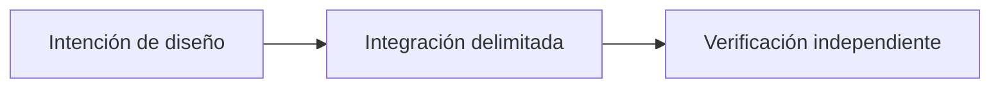

# Más allá del P2P Trading: la visión de Sails Protocol

*Borrador editorial. Temporada 4. Publicación no aprobada.*

## La pregunta

¿Qué viene después del primer SDK? Una familia de capacidades solo sirve si comparte reglas económicas explícitas.

## Decisión y límite

El primer foco es P2P Trading. Identidad, pruebas, reputación, liquidación, liquidez, agentes y finanzas son direcciones modulares distintas, no un producto ya desplegado. Cada módulo debe declarar quién tiene autoridad, qué efecto económico puede solicitar y qué invariante conserva. El documento de invariantes distingue arquitectura, obligaciones de implementación y evidencia ejecutable.

## Fallo y evidencia

Una billetera puede integrar una función OpenFinance y asumir que el protocolo garantiza a su proveedor externo de préstamos. Eso trasladaría responsabilidad sin prueba. Cada proveedor necesita su propio modelo de autoridad, gestión de fallos y gate; ninguna función del roadmap hereda la madurez del Trading SDK.

## Siguiente pregunta

¿Qué módulo puede demostrar una integración real, acotada y con evidencia reproducible de forma independiente?

## Flujo conceptual

Equivalente textual: la propuesta pasa de la intención de diseño a una integración delimitada y luego a la verificación independiente. No es un informe de implementación.

*Pendiente: verificación en fuentes técnicas, citas específicas, revisión editorial y aprobación del responsable.*

## Un límite concreto: una oferta de préstamo no es una garantía del protocolo

Imaginemos una aplicación que muestra una propuesta de préstamo de un proveedor externo junto a una operación P2P. El usuario ve una interfaz única y supone que ambas acciones comparten reglas de disputa, custodia y recuperación. Si el proveedor cambia las condiciones o deja de estar disponible después de autorizar una transferencia, un registro de coordinación no puede deshacer su contrato externo. La aplicación debe distinguir quién solicita la acción, quién autoriza la firma, qué proveedor ejecuta la operación y dónde se verifica la liquidación definitiva.

Una alternativa consiste en agrupar todas las capacidades bajo un servicio con marca y estado unificados. Esto simplifica la experiencia, pero puede ocultar permisos, obligaciones jurídicas y fallos independientes. Una interfaz modular exige identificar al proveedor y confirmar acciones por separado, pero permite auditar los límites de autoridad y recuperación. Una integración no hereda garantías de seguridad solo porque otro módulo haya superado sus pruebas.

## Evidencia y siguiente verificación

Antes de presentar un módulo futuro como disponible, deben identificarse el commit exacto, el adaptador y la interfaz implementados, las redes admitidas, las comprobaciones de autorización, las pruebas de fallos y reintentos y la observación de liquidación específica del proveedor. Una hoja de ruta, un diagrama de arquitectura o un CI verde del Trading SDK no bastan.

**Prueba de fallo propuesta:** aceptar una solicitud de un proveedor externo, retrasar su confirmación final de liquidación, reiniciar la aplicación y reintentar. Comprobar que se conserva el estado pendiente, que no aparece una segunda intención económica y que la aceptación del proveedor no se presenta como finalidad del protocolo. No afirmamos que esta prueba exista ni que haya pasado. Los invariantes citados son contexto arquitectónico, no prueba de OpenFinance desplegado.

## Límite examinado y fallo

Los módulos futuros siguen en el roadmap hasta su implementación y verificación propias. **Fallo:** presentar diseño como despliegue verificado. La fuente fijada solo respalda este alcance; siguen pendientes los gates de ejecución y CTO.

- [PROTOCOL_INVARIANTS.md](https://github.com/sails-protocol/Sails-Protocol/blob/be6d3bc2ddfc384cfafa4276e01b8aacc096d421/docs/PROTOCOL_INVARIANTS.md)
