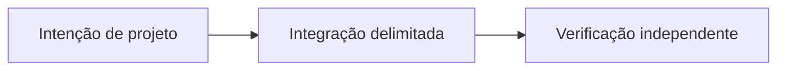

# Além do P2P Trading: a visão do Sails Protocol

*Rascunho editorial. Temporada 4. Publicação não aprovada.*

## A questão

 

## Direção de projeto

m

## Evidência antes das afirmações

n

## Fluxo conceitual

Equivalente textual: a proposta vai da intenção de projeto para uma integração delimitada e depois para verificação independente. Não é um relatório de implementação.

*Pendente: verificação na fonte técnica, citações específicas, revisão editorial e aprovação do responsável.*

## Fronteira examinada e falha

Módulos futuros permanecem no roadmap até implementação e verificação próprias. **Falha:** apresentar design como implantação comprovada. A fonte fixada sustenta apenas esse escopo; gates de execução e CTO seguem abertos.

- [PROTOCOL_INVARIANTS.md](https://github.com/sails-protocol/Sails-Protocol/blob/be6d3bc2ddfc384cfafa4276e01b8aacc096d421/docs/PROTOCOL_INVARIANTS.md)
