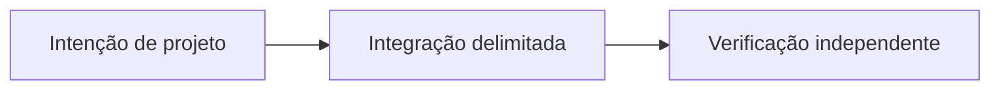

# Além do P2P Trading: a visão do Sails Protocol

*Rascunho editorial. Temporada 4. Publicação não aprovada.*

## A pergunta

O que um protocolo se torna depois do primeiro SDK? Uma família de capacidades só tem valor se compartilhar regras econômicas explícitas.

## Decisão e fronteira

O primeiro foco é o P2P Trading. Identidade, provas, reputação, liquidação, liquidez, agentes e finanças são direções modulares diferentes, não um único produto já implantado. Cada módulo precisa declarar quem tem autoridade, que efeito econômico pode solicitar e qual invariante preserva. O documento de invariantes separa arquitetura, obrigações de implementação e evidência executável.

## Falha e evidência

Uma carteira pode integrar um recurso OpenFinance e supor que o protocolo garante seu provedor externo de crédito. Isso transferiria responsabilidade sem prova. Cada provedor precisa de modelo de autoridade, tratamento de falhas e gate próprios; nenhuma funcionalidade do roadmap herda prontidão do Trading SDK.

## Próxima pergunta

Qual módulo consegue demonstrar uma integração real, delimitada e com evidência reproduzível de forma independente?

## Fluxo conceitual

Equivalente textual: a proposta vai da intenção de projeto para uma integração delimitada e depois para verificação independente. Não é um relatório de implementação.

*Pendente: verificação na fonte técnica, citações específicas, revisão editorial e aprovação do responsável.*

## Uma fronteira concreta: oferta de crédito não é garantia do protocolo

Imagine uma aplicação exibindo uma proposta de empréstimo de um provedor externo ao lado de uma negociação P2P. O usuário vê uma interface única e presume que as mesmas regras de disputa, custódia e recuperação se aplicam às duas ações. Se o provedor alterar as condições ou ficar indisponível depois da autorização de uma transferência, um registro de coordenação não poderá desfazer o contrato externo. A aplicação precisa distinguir quem solicita a ação, quem autoriza a assinatura, qual provedor executa a operação e onde se verifica a liquidação final.

Uma alternativa seria concentrar todas as capacidades em um serviço com marca e estado unificados. Isso simplifica a experiência, mas pode esconder permissões, obrigações jurídicas e falhas independentes. Uma interface modular exige identificar o provedor e confirmar ações separadamente, mas torna auditáveis os limites de autoridade e recuperação. Uma integração não herda garantias de segurança apenas porque outro módulo passou nos testes.

## Evidências e próxima verificação

Antes de apresentar um módulo futuro como disponível, é necessário identificar commit exato, adaptador e interface implementados, redes suportadas, verificações de autorização, testes de falha e repetição e observação de liquidação específica do provedor. Roadmap, diagrama de arquitetura ou CI verde do Trading SDK não bastam.

**Teste de falha proposto:** aceitar a solicitação de um provedor externo, atrasar a confirmação final de liquidação, reiniciar a aplicação e repetir a operação. Verificar se o estado pendente é preservado, se não surge uma segunda intenção econômica e se o aceite do provedor não é chamado de finalidade do protocolo. Não afirmamos que esse teste já exista ou tenha passado. As invariantes citadas são contexto arquitetural, não prova de OpenFinance implantado.

## Fronteira examinada e falha

Módulos futuros permanecem no roadmap até implementação e verificação próprias. **Falha:** apresentar design como implantação comprovada. A fonte fixada sustenta apenas esse escopo; gates de execução e CTO seguem abertos.

- [PROTOCOL_INVARIANTS.md](https://github.com/sails-protocol/Sails-Protocol/blob/be6d3bc2ddfc384cfafa4276e01b8aacc096d421/docs/PROTOCOL_INVARIANTS.md)
