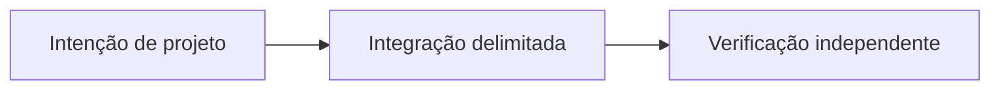

# Além do P2P Trading: a visão do Sails Protocol

*Rascunho editorial. Temporada 4. Publicação não aprovada.*

## A pergunta

O que um protocolo se torna depois do primeiro SDK? Uma família de capacidades só tem valor se compartilhar regras econômicas explícitas.

## Decisão e fronteira

O primeiro foco é o P2P Trading. Identidade, provas, reputação, liquidação, liquidez, agentes e finanças são direções modulares diferentes, não um único produto já implantado. Cada módulo precisa declarar quem tem autoridade, que efeito econômico pode solicitar e qual invariante preserva. O documento de invariantes separa arquitetura, obrigações de implementação e evidência executável.

## Falha e evidência

Uma carteira pode integrar um recurso OpenFinance e supor que o protocolo garante seu provedor externo de crédito. Isso transferiria responsabilidade sem prova. Cada provedor precisa de modelo de autoridade, tratamento de falhas e gate próprios; nenhuma funcionalidade do roadmap herda prontidão do Trading SDK.

## Próxima pergunta

Qual módulo consegue demonstrar uma integração real, delimitada e com evidência reproduzível de forma independente?

## Fluxo conceitual

Equivalente textual: a proposta vai da intenção de projeto para uma integração delimitada e depois para verificação independente. Não é um relatório de implementação.

*Pendente: verificação na fonte técnica, citações específicas, revisão editorial e aprovação do responsável.*

## Fronteira examinada e falha

Módulos futuros permanecem no roadmap até implementação e verificação próprias. **Falha:** apresentar design como implantação comprovada. A fonte fixada sustenta apenas esse escopo; gates de execução e CTO seguem abertos.

- [PROTOCOL_INVARIANTS.md](https://github.com/sails-protocol/Sails-Protocol/blob/be6d3bc2ddfc384cfafa4276e01b8aacc096d421/docs/PROTOCOL_INVARIANTS.md)
