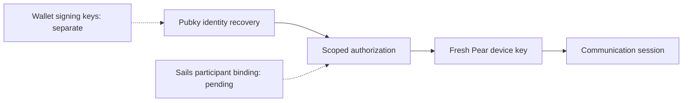

# OpenIdentity: Identity Without Platform Lock-in

*Season 4, article 21. Editorial draft, 26 October 2026. NOT approved or published. Evidence describes an isolated experiment, not a Day 0 integration.*

## The question: what actually comes back after a reinstall?

Alice trades through one Sails-integrated app, then loses her phone. She wants to recover her identity on another device and continue a conversation through a different integrator. Recovering a public identifier is not the same as recovering message history, settlement evidence, or reputation. Nor does a valid login signature authorize the release of escrow.

For Sails Protocol, portability must cross **four different boundaries** without collapsing them: economic participant identity, device/transport authorization, portable evidence and reputation, and funds signing authority. One credential cannot safely be assumed to restore all four.

## Boundary and design decision

The Sails identity investigation documents a registered Ed25519 economic participant key, a separate ephemeral Pear transport key, and a distinct WDK-related funds domain. It also identifies an earlier documentation drift: the transport key is **not** automatically the economic identity key. The Pubky-first direction is described in a [draft CTO reconciliation](https://github.com/sails-protocol/Sails-Protocol/pull/542), not as deployed Sails functionality.

An isolated [Pubky/Pear prototype](https://github.com/sails-protocol/Sails-Protocol/pull/543) explored two approaches. Its subsequent [homeserver experiment](https://github.com/sails-protocol/Sails-Protocol/pull/545) tested the proposed **model B**: restore a Pubky identity through Pubky's native recovery, create a fresh Pear device key, then obtain scoped authorization from the identity holder. The integrator should not receive the Pubky private key or a wallet seed. The [ADR remains proposed](https://github.com/sails-protocol/Sails-Protocol/blob/d288aab0140cb0c64b26dcbc9ad44aeefe2286ae/experiments/pubky-pear-recovery/ADR-PROPOSAL.md); it is not an accepted protocol contract.

This design deliberately sacrifices the simplicity of deriving every key from one secret. In return, compromise of a chat device need not expose the identity root or spending keys, and a device can be re-authorized rather than treated as the user's permanent identity.

## Failure: revocation is not an offline signature check

Imagine that Alice revokes a stolen device. An integrator verifies a previously issued signed statement offline and accepts it anyway. The signature can still be cryptographically valid even though the authority was withdrawn.

The isolated experiment found that offline grant verification did **not** detect revocation. Homeserver-side revocation worked in the tested environment, but a third-party online probe depended on undocumented server behavior. The later proposal therefore treats that probe as diagnostic, **not** as an authorization oracle. A bounded-freshness directory policy was tested as an alternative, but it depends on the homeserver for freshness and cannot defeat a malicious server that ignores revocation. Immediate cross-integrator revocation remains a blocker, not a solved feature.

The tested SDK signer path also issued grants with a two-year lifetime; shorter signed session statements limit exposure but do not magically shorten the upstream grant. These are security constraints requiring an explicit threat model and independent review, not merely interface details.

## What a recovered identity does not restore

**Messages:** a fresh Pear key is not a backup of previous ciphertext or chat state. The prototype did not establish production mobile, NAT/relay or offline-delivery behavior.

**Evidence:** a signed lab receipt is not automatically a valid OpenProof record. The [contract comparison](https://github.com/sails-protocol/Sails-Protocol/blob/d288aab0140cb0c64b26dcbc9ad44aeefe2286ae/experiments/pubky-pear-recovery/RECEIPTS-VS-CONTRACTS.md) identifies different identifiers, hashes, signatures and authority models. Some existing evidence and event-chain fields are server-asserted, not portable third-party attestations.

**Reputation:** current OpenReputation scoring is derived from server-side settlement outcomes, not from the lab's signed receipt chain. A portable score or history would require identity binding, an exportable outcome attestation, anti-truncation guarantees and privacy decisions that are not implemented by this experiment.

**Funds:** identity recovery must never be presented as recovery of a wallet's spending keys. Authentication, trade authorization, escrow execution and funds custody remain distinct.

## Evidence and maturity

| Claim | Evidence status |
| --- | --- |
| Native Pubky recovery and re-authorizing a Pear key | Tested in an isolated homeserver prototype; not Sails production |
| Scoped grants, expiry and revocation | Tested in bounded conditions; immediate third-party revocation unresolved |
| Pubky-to-Sails participant binding | Proposed, not integrated |
| Portable OpenProof receipts and OpenReputation | Contract gaps documented; not proven interoperable |
| Production Pear chat recovery and wallet recovery | Not established |

The [homeserver evidence](https://github.com/sails-protocol/Sails-Protocol/blob/d288aab0140cb0c64b26dcbc9ad44aeefe2286ae/experiments/pubky-pear-recovery/homeserver/README.md) and [receipt-contract audit](https://github.com/sails-protocol/Sails-Protocol/blob/d288aab0140cb0c64b26dcbc9ad44aeefe2286ae/experiments/pubky-pear-recovery/RECEIPTS-VS-CONTRACTS.md) are pinned to the experimental PR head `d288aab0140cb0c64b26dcbc9ad44aeefe2286ae`. Test results are reported by the experiment authors; this editorial draft has not independently rerun them. The protocol's [identity architecture discovery](https://github.com/sails-protocol/Sails-Protocol/blob/d288aab0140cb0c64b26dcbc9ad44aeefe2286ae/docs/IDENTITY_ARCHITECTURE_DISCOVERY.md) documents the separation of trust domains. The prototype changed no Sails Core, schemas, contracts, CI or production deployment.

## Conceptual boundary diagram

*Text equivalent:* native identity recovery can authorize a new communication device, while the binding to a Sails economic participant is still pending and wallet signing authority remains separate. The diagram is conceptual, not a deployed architecture.

## The next question

What minimal, versioned, independently verifiable binding can connect a Pubky identity to a Sails participant and portable settlement evidence without exposing spending keys or creating a permanently public graph of a user's counterparties? Until that is answered and tested, **one recovery experience** is a product goal, not proof of **one portable identity, messages, history and reputation**.

*Editorial gates pending: independent technical and security review, claim review, EN/PT-BR/ES localization signoff, legal review if required, exact-head CI, owner approval and verified publication.*
