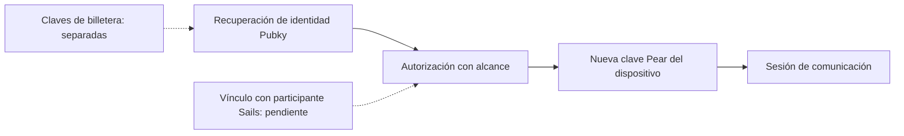

# OpenIdentity: identidad sin dependencia de una plataforma

*Temporada 4, artículo 21. Borrador editorial del 26 de octubre de 2026. NO aprobado ni publicado. Las evidencias describen un experimento aislado, no una integración Day 0.*

## La pregunta: ¿qué se recupera realmente al reinstalar?

Alice negocia mediante una aplicación integrada con Sails y pierde el teléfono. Quiere recuperar su identidad en otro dispositivo y continuar una conversación desde un segundo integrador. Recuperar un identificador público no equivale a recuperar mensajes, pruebas de liquidación o reputación. Una firma válida de inicio de sesión tampoco autoriza liberar fondos en escrow.

Para Sails Protocol, la portabilidad atraviesa **cuatro límites diferentes**: identidad económica del participante, autorización del dispositivo y transporte, pruebas y reputación portátiles, y autoridad para firmar movimientos de fondos. No debe suponerse que una sola credencial restaura todo eso.

## Límite y decisión de arquitectura

La investigación de identidad de Sails documenta una clave Ed25519 del participante económico, una clave Pear de transporte separada y efímera, y un dominio de claves financieras relacionado con WDK. También identifica documentación anterior desactualizada: la clave de transporte **no** es automáticamente la clave de identidad económica. La dirección Pubky-first figura en una [reconciliación del CTO todavía en borrador](https://github.com/sails-protocol/Sails-Protocol/pull/542), no como función desplegada.

Un [prototipo aislado Pubky/Pear](https://github.com/sails-protocol/Sails-Protocol/pull/543) comparó alternativas. El [experimento con homeserver](https://github.com/sails-protocol/Sails-Protocol/pull/545) probó el **modelo B propuesto**: recuperar la identidad mediante el mecanismo nativo de Pubky, crear una nueva clave Pear por dispositivo y solicitar una autorización limitada al titular. El integrador no debe recibir la clave privada Pubky ni la semilla de la billetera. La [ADR sigue siendo una propuesta](https://github.com/sails-protocol/Sails-Protocol/blob/d288aab0140cb0c64b26dcbc9ad44aeefe2286ae/experiments/pubky-pear-recovery/ADR-PROPOSAL.md), no un contrato aprobado.

Este diseño renuncia a derivar todas las claves de un solo secreto. A cambio, comprometer un dispositivo de chat no tiene por qué exponer la identidad raíz ni las claves de gasto, y se puede volver a autorizar un dispositivo sin convertirlo en la identidad permanente del usuario.

## Fallo: una firma válida no demuestra que siga vigente la autorización

Imaginemos que Alice revoca un dispositivo robado. Otro integrador comprueba sin conexión una declaración firmada antes de la revocación y permite el acceso. La firma puede seguir siendo criptográficamente válida aunque la autorización haya sido retirada.

En el experimento aislado, la verificación sin conexión **no** detectó la revocación. El homeserver aplicó la revocación en el entorno probado, pero una consulta de terceros dependía de un comportamiento no documentado. La propuesta posterior considera esa consulta diagnóstica, **no** una fuente válida de autorización. Se probó una alternativa de frescura limitada, pero depende del homeserver y no resiste a uno malicioso que ignore revocaciones. La revocación inmediata entre integradores sigue bloqueada.

La ruta de firma del SDK probada también emitía grants de dos años. Declaraciones de sesión más breves reducen la exposición, pero no acortan el grant original. Estas limitaciones requieren un modelo de amenazas y una revisión independiente.

## Lo que la identidad recuperada no devuelve

**Mensajes:** una nueva clave Pear no restaura mensajes cifrados ni su historial. El prototipo no demostró funcionamiento de producción en móviles, NAT/relay ni entrega sin conexión.

**Pruebas:** un recibo firmado en el laboratorio no se convierte automáticamente en un registro OpenProof. La [comparación con los contratos reales](https://github.com/sails-protocol/Sails-Protocol/blob/d288aab0140cb0c64b26dcbc9ad44aeefe2286ae/experiments/pubky-pear-recovery/RECEIPTS-VS-CONTRACTS.md) encontró diferencias en identificadores, hashes, firmas y autoridad. Algunos registros actuales dependen de afirmaciones del servidor, no de atestaciones portátiles verificables por terceros.

**Reputación:** la puntuación actual de OpenReputation procede de resultados de liquidación calculados por el servidor, no de la cadena experimental de recibos firmados. La portabilidad requiere vincular identidades, exportar atestaciones de resultados, impedir la omisión de historial y resolver cuestiones de privacidad todavía no implementadas por el experimento.

**Fondos:** recuperar la identidad no equivale a recuperar claves de gasto. Autenticación, autorización de operaciones, ejecución de escrow y custodia siguen siendo dominios distintos.

## Evidencias y madurez

| Afirmación | Estado de la evidencia |
| --- | --- |
| Recuperación nativa Pubky y nueva autorización Pear | Probadas en prototipo aislado, no en producción Sails |
| Grants con alcance, vencimiento y revocación | Pruebas delimitadas; revocación inmediata por terceros sin resolver |
| Vinculación de Pubky con el participante Sails | Propuesta, sin integración |
| Recibos OpenProof y OpenReputation portátiles | Brechas contractuales documentadas; interoperabilidad no demostrada |
| Recuperación de chats Pear y billeteras en producción | No demostrada |

Las [evidencias del homeserver](https://github.com/sails-protocol/Sails-Protocol/blob/d288aab0140cb0c64b26dcbc9ad44aeefe2286ae/experiments/pubky-pear-recovery/homeserver/README.md) y la [auditoría de contratos](https://github.com/sails-protocol/Sails-Protocol/blob/d288aab0140cb0c64b26dcbc9ad44aeefe2286ae/experiments/pubky-pear-recovery/RECEIPTS-VS-CONTRACTS.md) están vinculadas al HEAD experimental `d288aab0140cb0c64b26dcbc9ad44aeefe2286ae`. Los resultados proceden de los autores del experimento y no se volvieron a ejecutar de forma independiente para este borrador. La [investigación de identidad](https://github.com/sails-protocol/Sails-Protocol/blob/d288aab0140cb0c64b26dcbc9ad44aeefe2286ae/docs/IDENTITY_ARCHITECTURE_DISCOVERY.md) documenta los límites de autoridad. El prototipo no cambió Core, esquemas, contratos, CI ni producción de Sails.

## Diagrama conceptual de límites

*Equivalente textual:* la recuperación nativa de la identidad puede autorizar un nuevo dispositivo de comunicación, pero el vínculo con el participante económico Sails sigue pendiente y la autoridad sobre fondos permanece separada. Es un diseño conceptual, no una arquitectura desplegada.

## La siguiente pregunta

¿Qué vínculo mínimo, versionado y verificable por terceros puede conectar una identidad Pubky con un participante Sails y con las pruebas de liquidación sin exponer claves de gasto ni crear un mapa público permanente de contrapartes? Hasta decidirlo y probarlo, **una experiencia de recuperación** es un objetivo de producto, no prueba de **una identidad, mensajes, historial y reputación portátiles**.

*Gates pendientes: revisión técnica y de seguridad independiente, revisión de afirmaciones, aprobación de las tres versiones, revisión jurídica cuando corresponda, CI del HEAD exacto, autorización del responsable y publicación verificada.*
