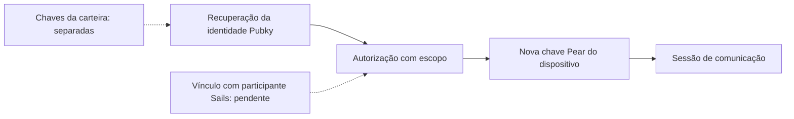

# OpenIdentity: identidade sem aprisionamento à plataforma

*Temporada 4, artigo 21. Rascunho editorial de 26 de outubro de 2026. NÃO aprovado nem publicado. As evidências descrevem um experimento isolado, não uma integração Day 0.*

## A pergunta: o que realmente volta depois de reinstalar?

Alice negocia por um aplicativo integrado ao Sails e perde o celular. Ela quer recuperar a identidade em outro aparelho e continuar uma conversa por um segundo integrador. Recuperar um identificador público não significa recuperar mensagens, evidências de liquidação ou reputação. Uma assinatura válida de login também não autoriza liberar um escrow.

Para o Sails Protocol, a portabilidade precisa atravessar **quatro fronteiras distintas**: identidade econômica do participante, autorização do dispositivo e transporte, evidências e reputação portáveis, e autoridade para assinar movimentações financeiras. Não se deve presumir que uma credencial restaure tudo isso.

## Fronteira e decisão de arquitetura

A investigação de identidade do Sails documenta uma chave Ed25519 do participante econômico, uma chave Pear de transporte separada e efêmera, e um domínio de chaves financeiras relacionado ao WDK. Também registra uma divergência em documentação anterior: a chave de transporte **não** é automaticamente a chave da identidade econômica. A direção Pubky-first aparece em uma [reconciliação do CTO ainda em draft](https://github.com/sails-protocol/Sails-Protocol/pull/542), não como funcionalidade em produção.

Um [protótipo isolado Pubky/Pear](https://github.com/sails-protocol/Sails-Protocol/pull/543) comparou alternativas. O [experimento com homeserver](https://github.com/sails-protocol/Sails-Protocol/pull/545) testou o **modelo B proposto**: recuperar a identidade pelo mecanismo nativo do Pubky, criar uma nova chave Pear para o dispositivo e obter uma autorização limitada do titular. O integrador não deve receber a chave privada Pubky nem a seed da carteira. A [ADR continua proposta](https://github.com/sails-protocol/Sails-Protocol/blob/d288aab0140cb0c64b26dcbc9ad44aeefe2286ae/experiments/pubky-pear-recovery/ADR-PROPOSAL.md), sem se tornar contrato aprovado do protocolo.

Essa opção abre mão de derivar todas as chaves de um único segredo. Em contrapartida, comprometer um dispositivo de conversa não precisa expor a identidade raiz nem as chaves financeiras, e um novo dispositivo pode ser autorizado sem se tornar a identidade permanente do usuário.

## Falha: assinatura válida não prova ausência de revogação

Imagine que Alice revogue um dispositivo roubado. Um integrador verifica offline uma declaração assinada anteriormente e aceita o acesso. A assinatura pode continuar matematicamente válida mesmo depois da revogação.

No experimento isolado, a verificação offline **não** identificou a revogação. O homeserver aplicou a revogação no ambiente testado, mas uma consulta online feita por terceiros dependia de comportamento não documentado. A proposta posterior trata essa consulta como diagnóstico, **não** como autoridade de autorização. Foi testada uma alternativa com atualização limitada no tempo, mas ela depende do homeserver e não resiste a um servidor malicioso que ignore revogações. Revogação imediata entre integradores continua sendo bloqueio.

O caminho de assinatura do SDK testado também emitia grants com duração de dois anos. Declarações de sessão mais curtas reduzem a exposição, mas não encurtam o grant original. São restrições de segurança que exigem modelo de ameaças e revisão independente.

## O que a identidade recuperada não recupera

**Mensagens:** uma nova chave Pear não contém backup de mensagens cifradas nem do histórico. O protótipo não comprovou operação de produção em mobile, NAT/relay ou entrega offline.

**Evidências:** um recibo assinado no laboratório não vira automaticamente registro OpenProof. A [comparação com contratos reais](https://github.com/sails-protocol/Sails-Protocol/blob/d288aab0140cb0c64b26dcbc9ad44aeefe2286ae/experiments/pubky-pear-recovery/RECEIPTS-VS-CONTRACTS.md) encontrou diferenças em identificadores, hashes, assinaturas e autoridade. Parte dos registros atuais é afirmada pelo servidor, não atestada de modo portável por terceiros.

**Reputação:** a pontuação atual de OpenReputation deriva de resultados de liquidação calculados no servidor, não da cadeia experimental de recibos assinados. Portabilidade exige vínculo de identidade, atestação exportável do resultado, proteção contra omissão de histórico e decisões de privacidade ainda não implementadas pelo experimento.

**Fundos:** recuperar identidade não significa recuperar chaves para gastar fundos. Autenticação, autorização de negociação, execução de escrow e custódia permanecem separadas.

## Evidências e maturidade

| Afirmação | Estado da evidência |
| --- | --- |
| Recuperação nativa Pubky e nova autorização Pear | Testadas em protótipo isolado, não em produção Sails |
| Grants com escopo, validade e revogação | Testes delimitados; revogação imediata por terceiros não resolvida |
| Vínculo Pubky com participante Sails | Proposta, sem integração |
| Recibos OpenProof e OpenReputation portáveis | Lacunas contratuais documentadas; interoperabilidade não comprovada |
| Recuperação de chat Pear em produção e de carteira | Não comprovada |

As [evidências do homeserver](https://github.com/sails-protocol/Sails-Protocol/blob/d288aab0140cb0c64b26dcbc9ad44aeefe2286ae/experiments/pubky-pear-recovery/homeserver/README.md) e a [auditoria dos contratos](https://github.com/sails-protocol/Sails-Protocol/blob/d288aab0140cb0c64b26dcbc9ad44aeefe2286ae/experiments/pubky-pear-recovery/RECEIPTS-VS-CONTRACTS.md) apontam para o HEAD experimental `d288aab0140cb0c64b26dcbc9ad44aeefe2286ae`. Os resultados são relatados pelos autores do experimento e não foram reexecutados de forma independente nesta revisão editorial. A [investigação de identidade](https://github.com/sails-protocol/Sails-Protocol/blob/d288aab0140cb0c64b26dcbc9ad44aeefe2286ae/docs/IDENTITY_ARCHITECTURE_DISCOVERY.md) documenta a separação de autoridades. O protótipo não alterou Core, schemas, contratos, CI nem produção do Sails.

## Diagrama conceitual das fronteiras

*Equivalente textual:* a recuperação nativa da identidade pode autorizar um novo dispositivo de comunicação, mas o vínculo com o participante econômico Sails continua pendente e a autoridade financeira permanece separada. O desenho é conceitual, não uma arquitetura implantada.

## Próxima pergunta

Qual vínculo mínimo, versionado e verificável por terceiros pode conectar uma identidade Pubky ao participante Sails e às evidências de liquidação sem expor chaves financeiras nem criar um mapa público permanente das contrapartes? Até isso ser decidido e testado, **uma experiência de recuperação** é objetivo de produto, não prova de **uma identidade, mensagens, histórico e reputação portáveis**.

*Gates pendentes: revisão técnica e de segurança independente, revisão de afirmações, aprovação das três versões, análise jurídica quando aplicável, CI no HEAD exato, autorização do responsável e publicação verificada.*
