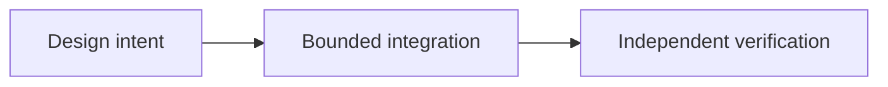

# OpenProof: Verifiable Evidence for P2P Systems

*Editorial draft. Season 4. Not approved for publication.*

## The question

What can a trading system actually prove when a participant uploads a receipt? A file can be genuine and still refer to the wrong payment. Authenticity of bytes is not the same as truth of the claim.

## The boundary and decision

OpenProof aims to record attributable evidence without turning the evidence store into a bank or settlement oracle. In the inspected proof service, an Ed25519 signature binds a SHA-256 digest of media to a key. The service also checks access to the associated claim. This can support provenance; it cannot independently establish that a transfer settled. Larger or non-inline evidence belongs on the EvidenceProvider path, with resource policies verified separately from the conceptual model.

## Failure and verification

A buyer submits an authentic receipt for an unrelated transfer. The signature verifies, but the seller has not been paid. A safe workflow must keep provenance, relevance and external payment confirmation separate. Another failure is accepting oversized evidence before enforcing resource limits. Exact-head boundary tests should demonstrate rejection without downstream economic, storage or event side effects; no such new runtime test was run for this article.

## The next question

Who is authorized to submit each reference, and what independent authority can connect the evidence to the actual payment?

## Conceptual flow

Text equivalent: the proposal progresses from design intent to a bounded integration and then to independent verification. This is not an implementation status report.

*Pending: source-of-truth verification, specific citations, editorial review and owner approval.*

## Scenario: an authentic receipt for a different obligation

A buyer attaches a correctly signed receipt from an earlier payment to a new trade. The media digest and signer check out, but the amount, beneficiary, reference and timing do not match the current obligation. If an application equates valid media provenance with payment completion, escrow may be released without the seller receiving the intended funds.

A second failure involves resource exhaustion: a participant submits repeated oversized or deeply nested evidence to force expensive parsing or storage before limits are enforced. Validation order and per-claim quotas matter independently of signature correctness.

## Trade-off and verification

Accepting any signed artifact is easy to implement but shifts payment truth onto an untrusted uploader. Separating media provenance, trade relevance, independent payment observation and bounded storage adds verification work while preventing false certainty. External evidence providers require their own retention and availability model.

**Next test:** attach a valid signed receipt from another trade, then submit malformed and oversized evidence under concurrent retries. Confirm that invalid references cannot authorize settlement and that rejection occurs before economic or durable storage side effects. Inspect the exact implementation, provider boundaries and configured limits. The linked service file alone does not certify end-to-end payment truth.

## Inspected boundary, not production certification

Signed media attribution is not independent payment truth. **Failure:** confusing a documented design with deployed behavior. Exact-head integration and runtime verification remain required.

- [proof.service.ts](https://github.com/sails-protocol/Sails-Protocol/blob/be6d3bc2ddfc384cfafa4276e01b8aacc096d421/src/modules/open-proof/proof.service.ts)
