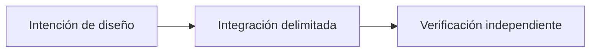

# OpenProof: evidencias verificables para sistemas P2P

*Borrador editorial. Temporada 4. Publicación no aprobada.*

## La cuestión

f

## Dirección de diseño

 

## Evidencia antes de las afirmaciones

 

## Flujo conceptual

Equivalente textual: la propuesta pasa de la intención de diseño a una integración delimitada y luego a la verificación independiente. No es un informe de implementación.

*Pendiente: verificación en fuentes técnicas, citas específicas, revisión editorial y aprobación del responsable.*

## Límite examinado, no certificación de producción

La atribución de medios firmados no demuestra un pago externo. **Fallo:** confundir diseño documentado con comportamiento desplegado. Faltan pruebas de integración y ejecución del HEAD exacto.

- [proof.service.ts](https://github.com/sails-protocol/Sails-Protocol/blob/be6d3bc2ddfc384cfafa4276e01b8aacc096d421/src/modules/open-proof/proof.service.ts)
