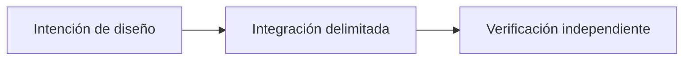

# OpenProof: evidencias verificables para sistemas P2P

*Borrador editorial. Temporada 4. Publicación no aprobada.*

## La pregunta

¿Qué demuestra un sistema cuando alguien presenta un comprobante? Un archivo puede ser auténtico y corresponder a otro pago. Autenticidad de los bytes no equivale a veracidad de la afirmación.

## El límite y la decisión

OpenProof busca registrar evidencias atribuibles sin convertir su almacenamiento en un oráculo de liquidación. En el servicio inspeccionado, Ed25519 vincula el digest SHA-256 del medio a una clave, y se verifica el acceso a la reclamación. Esto ayuda a establecer procedencia, pero no demuestra que se liquidó una transferencia. Las evidencias grandes o no inline siguen la vía de EvidenceProvider, cuyos límites requieren verificación propia.

## Fallo y verificación

Un comprador presenta un comprobante auténtico de otra transferencia. La firma es válida, pero el vendedor no ha cobrado. Procedencia, relevancia y confirmación externa deben mantenerse separadas. Otro riesgo es admitir evidencias excesivas antes de aplicar los límites de recursos. Las pruebas del HEAD exacto deben demostrar rechazo sin efectos económicos, de almacenamiento ni eventos posteriores; aquí no se ejecutaron pruebas nuevas.

## Siguiente pregunta

¿Quién puede presentar cada referencia y qué autoridad independiente conecta la evidencia con el pago real?

## Flujo conceptual

Equivalente textual: la propuesta pasa de la intención de diseño a una integración delimitada y luego a la verificación independiente. No es un informe de implementación.

*Pendiente: verificación en fuentes técnicas, citas específicas, revisión editorial y aprobación del responsable.*

## Escenario: comprobante auténtico de otra obligación

Un comprador adjunta a una operación nueva un comprobante correctamente firmado de un pago anterior. El digest del archivo y la firma son válidos, pero el importe, beneficiario, referencia y momento no corresponden a la obligación actual. Si la aplicación equipara procedencia válida con pago completado, podría liberar escrow sin que el vendedor haya recibido los fondos previstos.

Otro fallo es el agotamiento de recursos: un participante envía repetidamente evidencias excesivas o profundamente anidadas, forzando procesamiento o almacenamiento costoso antes de aplicar límites. El orden de validación y las cuotas por reclamación importan independientemente de la firma.

## Alternativa y verificación

Aceptar cualquier archivo firmado es sencillo, pero delega la verdad del pago a quien presenta evidencia no confiable. Separar procedencia, relevancia para la operación, observación independiente del pago y almacenamiento limitado exige más comprobaciones, pero evita una certeza falsa. Los proveedores externos de evidencia necesitan sus propias reglas de retención y disponibilidad.

**Siguiente prueba:** adjuntar un comprobante firmado válido de otra operación y después enviar evidencia malformada y excesiva mediante reintentos concurrentes. Comprobar que las referencias inválidas no autorizan liquidación y que el rechazo ocurre antes de efectos económicos o almacenamiento duradero. Revisar implementación exacta, límites del proveedor y configuración de recursos. El archivo del servicio citado no certifica la verdad del pago de extremo a extremo.

## Límite examinado, no certificación de producción

La atribución de medios firmados no demuestra un pago externo. **Fallo:** confundir diseño documentado con comportamiento desplegado. Faltan pruebas de integración y ejecución del HEAD exacto.

- [proof.service.ts](https://github.com/sails-protocol/Sails-Protocol/blob/be6d3bc2ddfc384cfafa4276e01b8aacc096d421/src/modules/open-proof/proof.service.ts)
