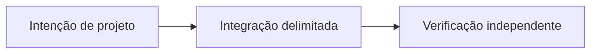

# OpenProof: evidências verificáveis para sistemas P2P

*Rascunho editorial. Temporada 4. Publicação não aprovada.*

## A pergunta

O que um sistema comprova quando alguém envia um recibo? Um arquivo pode ser autêntico e pertencer a outro pagamento. Autenticidade dos bytes não é verdade da alegação.

## A fronteira e a decisão

OpenProof busca registrar evidências atribuíveis sem transformar armazenamento em oráculo de liquidação. No serviço examinado, Ed25519 vincula o digest SHA-256 da mídia a uma chave, e o acesso à alegação é verificado. Isso ajuda a estabelecer procedência, mas não comprova que uma transferência foi liquidada. Evidências maiores ou não inline seguem o caminho do EvidenceProvider, cujos limites exigem verificação própria.

## Falha e verificação

Um comprador envia um comprovante autêntico de outra transferência. A assinatura é válida, mas o vendedor não recebeu. Procedência, relevância e confirmação externa precisam permanecer separadas. Outro risco é aceitar evidência grande demais antes dos limites de recursos. Testes no HEAD exato devem comprovar rejeição sem efeitos econômicos, de armazenamento ou eventos posteriores; nenhum novo teste foi executado aqui.

## Próxima pergunta

Quem pode enviar cada referência e qual autoridade independente conecta a evidência ao pagamento real?

## Fluxo conceitual

Equivalente textual: a proposta vai da intenção de projeto para uma integração delimitada e depois para verificação independente. Não é um relatório de implementação.

*Pendente: verificação na fonte técnica, citações específicas, revisão editorial e aprovação do responsável.*

## Cenário: comprovante autêntico de outra obrigação

Um comprador anexa a uma nova negociação um comprovante corretamente assinado de pagamento anterior. O digest da mídia e a assinatura conferem, mas valor, beneficiário, referência e horário não correspondem à obrigação atual. Se a aplicação equiparar procedência válida à conclusão do pagamento, poderá liberar escrow sem que o vendedor tenha recebido os fundos esperados.

Outra falha envolve exaustão de recursos: um participante envia repetidamente evidências grandes demais ou profundamente aninhadas, forçando processamento ou armazenamento caro antes da aplicação dos limites. A ordem das validações e as cotas por alegação importam independentemente da assinatura.

## Alternativa e verificação

Aceitar qualquer arquivo assinado é simples, mas transfere a verdade do pagamento a quem enviou uma evidência não confiável. Separar procedência, relevância para a negociação, observação independente do pagamento e armazenamento limitado exige mais verificações, porém evita falsa certeza. Provedores externos de evidências precisam de regras próprias de retenção e disponibilidade.

**Próximo teste:** anexar comprovante válido de outra negociação e depois enviar evidências malformadas ou grandes demais em tentativas concorrentes. Verificar que referências inválidas não autorizam liquidação e que a rejeição ocorre antes de efeitos econômicos ou armazenamento durável. Conferir implementação exata, limites do provedor e configuração de recursos. O arquivo do serviço citado não certifica a verdade do pagamento de ponta a ponta.

## Fronteira examinada, não certificação de produção

Atribuição de mídia assinada não comprova pagamento externo. **Falha:** confundir design documentado com comportamento implantado. Ainda são necessários testes de integração e execução no HEAD exato.

- [proof.service.ts](https://github.com/sails-protocol/Sails-Protocol/blob/be6d3bc2ddfc384cfafa4276e01b8aacc096d421/src/modules/open-proof/proof.service.ts)
