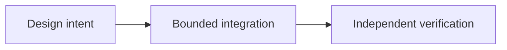

# OpenReputation: Trust Across Applications

*Editorial draft. Season 4. Not approved for publication.*

## The question

Can a good reputation in one market be trusted in another? Only with context.

## Design decision and boundary

OpenReputation is a direction for portable, attributable signals, not a universal score. The participant model defines actors but does not implement cross-market scoring or a common trust policy. Each receiving application must choose what it accepts.

## Failure and evidence

A successful trade signal stripped of payment rail, dispute history and issuer can mislead another market. Prove provenance, consent, revocation and receiving-market policy before making portability claims.

## Conceptual flow

Text equivalent: the proposal progresses from design intent to a bounded integration and then to independent verification. This is not an implementation status report.

*Pending: source-of-truth verification, specific citations, editorial review and owner approval.*

## Inspected boundary and failure

Participant identity is not a universal portable reputation score. **Failure:** overstating design as verified deployment. The pinned source supports only the stated scope; runtime and CTO gates remain open.

- [RFC-001-participant-model.md](https://github.com/sails-protocol/Sails-Protocol/blob/be6d3bc2ddfc384cfafa4276e01b8aacc096d421/docs/rfcs/RFC-001-participant-model.md)
