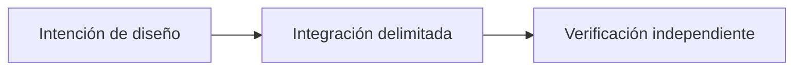

# OpenReputation: confianza entre aplicaciones

*Borrador editorial. Temporada 4. Publicación no aprobada.*

## La cuestión

p

## Dirección de diseño

p

## Evidencia antes de las afirmaciones

 

## Flujo conceptual

Equivalente textual: la propuesta pasa de la intención de diseño a una integración delimitada y luego a la verificación independiente. No es un informe de implementación.

*Pendiente: verificación en fuentes técnicas, citas específicas, revisión editorial y aprobación del responsable.*

## Alcance respaldado por fuente

La identidad de participante no es reputación universal portable. **Fallo:** tratar diseño o API inspeccionada como preparación universal de producción. Faltan pruebas del HEAD exacto y aprobación.

- [RFC-001-participant-model.md](https://github.com/sails-protocol/Sails-Protocol/blob/be6d3bc2ddfc384cfafa4276e01b8aacc096d421/docs/rfcs/RFC-001-participant-model.md)
