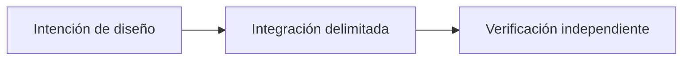

# OpenReputation: confianza entre aplicaciones

*Borrador editorial. Temporada 4. Publicación no aprobada.*

## La pregunta

¿Sirve una buena reputación de un mercado en otro? Solo con contexto.

## Decisión y límite

OpenReputation propone señales portables y atribuibles, no una puntuación universal. El modelo define participantes, pero no implementa puntuación entre mercados ni una política común. Cada aplicación decide qué acepta.

## Fallo y evidencia

Una señal de operación exitosa sin red de pago, historial de disputas ni emisor puede engañar a otro mercado. Probar procedencia, consentimiento, revocación y política local antes de prometer portabilidad.

## Flujo conceptual

Equivalente textual: la propuesta pasa de la intención de diseño a una integración delimitada y luego a la verificación independiente. No es un informe de implementación.

*Pendiente: verificación en fuentes técnicas, citas específicas, revisión editorial y aprobación del responsable.*

## Escenario: una señal portable de éxito pierde su contexto

Un vendedor completa diez operaciones pequeñas en un mercado. Otra aplicación importa una puntuación positiva sin indicar mercado emisor, importes, medios de pago, disputas ni período. Después trata al vendedor como confiable para una obligación mucho mayor y diferente. Aunque todos los eventos originales sean auténticos, la nueva conclusión no se desprende de la evidencia.

Un participante malicioso también podría reutilizar una señal positiva antigua después de una disputa posterior o de retirar el consentimiento. La identidad portable por sí sola no indica si la señal sigue siendo actual, representativa o relevante.

## Decisión y siguiente prueba

Una puntuación universal es cómoda, pero elimina contexto y gobernanza. Una alternativa más prudente es transportar afirmaciones atribuibles sobre eventos con emisor, alcance, fecha, procedencia, consentimiento y revocación, dejando la evaluación de riesgo a cada mercado receptor. Esto aumenta el coste de interoperabilidad y exige protección de privacidad; no significa que la infraestructura esté desplegada.

**Siguiente prueba:** importar una señal válida pero antigua, omitir su contexto de disputa y revocar el consentimiento antes de reutilizarla. Comprobar que la aplicación receptora no la convierte silenciosamente en una garantía universal de confianza actual. El RFC de participantes identifica actores, no implementa un motor de reputación entre mercados.

## Alcance respaldado por fuente

La identidad de participante no es reputación universal portable. **Fallo:** tratar diseño o API inspeccionada como preparación universal de producción. Faltan pruebas del HEAD exacto y aprobación.

- [RFC-001-participant-model.md](https://github.com/sails-protocol/Sails-Protocol/blob/be6d3bc2ddfc384cfafa4276e01b8aacc096d421/docs/rfcs/RFC-001-participant-model.md)
