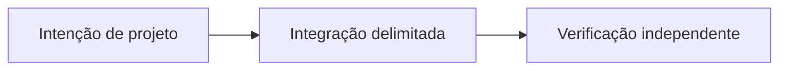

# OpenReputation: confiança entre aplicações

*Rascunho editorial. Temporada 4. Publicação não aprovada.*

## A pergunta

Boa reputação em um mercado vale em outro? Só com contexto.

## Decisão e fronteira

OpenReputation é uma direção para sinais portáveis e atribuíveis, não uma nota universal. O modelo define participantes, mas não implementa pontuação entre mercados ou política comum. Cada aplicação decide o que aceita.

## Falha e evidência

Um sinal de negociação bem-sucedida sem rede de pagamento, histórico de disputa e emissor pode enganar outro mercado. Comprovar procedência, consentimento, revogação e política local antes de prometer portabilidade.

## Fluxo conceitual

Equivalente textual: a proposta vai da intenção de projeto para uma integração delimitada e depois para verificação independente. Não é um relatório de implementação.

*Pendente: verificação na fonte técnica, citações específicas, revisão editorial e aprovação do responsável.*

## Cenário: um sinal portável de sucesso perde o contexto

Um vendedor conclui dez negociações pequenas em um mercado. Outra aplicação importa uma nota positiva sem identificar mercado emissor, valores, meios de pagamento, disputas ou período. Em seguida, trata o vendedor como confiável para uma obrigação muito maior e diferente. Mesmo que todos os eventos originais sejam autênticos, a nova conclusão não decorre das evidências.

Um participante malicioso também poderia reutilizar um sinal positivo antigo após uma disputa posterior ou a retirada do consentimento. Identidade portável, por si só, não informa se o sinal ainda é atual, representativo ou relevante.

## Decisão e próximo teste

Uma nota universal é conveniente, mas apaga contexto e governança. A alternativa mais prudente é transportar alegações de eventos atribuíveis com emissor, escopo, data, procedência, consentimento e revogação, deixando a avaliação de risco a cada mercado receptor. Isso aumenta o custo de interoperabilidade e exige proteção de privacidade; não significa que a infraestrutura esteja implantada.

**Próximo teste:** importar sinal de sucesso válido, porém antigo, omitir seu contexto de disputa e revogar consentimento antes da reutilização. Verificar que a aplicação receptora não o transforma silenciosamente em garantia universal de confiança atual. O RFC de participantes identifica atores, não implementa um mecanismo de reputação entre mercados.

## Escopo fundamentado em fonte

Identidade de participante não é reputação universal portável. **Falha:** tratar design ou API examinada como prontidão universal de produção. Testes no HEAD exato e aprovação seguem pendentes.

- [RFC-001-participant-model.md](https://github.com/sails-protocol/Sails-Protocol/blob/be6d3bc2ddfc384cfafa4276e01b8aacc096d421/docs/rfcs/RFC-001-participant-model.md)
