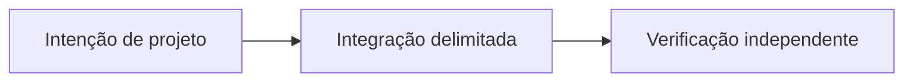

# OpenReputation: confiança entre aplicações

*Rascunho editorial. Temporada 4. Publicação não aprovada.*

## A pergunta

Boa reputação em um mercado vale em outro? Só com contexto.

## Decisão e fronteira

OpenReputation é uma direção para sinais portáveis e atribuíveis, não uma nota universal. O modelo define participantes, mas não implementa pontuação entre mercados ou política comum. Cada aplicação decide o que aceita.

## Falha e evidência

Um sinal de negociação bem-sucedida sem rede de pagamento, histórico de disputa e emissor pode enganar outro mercado. Comprovar procedência, consentimento, revogação e política local antes de prometer portabilidade.

## Fluxo conceitual

Equivalente textual: a proposta vai da intenção de projeto para uma integração delimitada e depois para verificação independente. Não é um relatório de implementação.

*Pendente: verificação na fonte técnica, citações específicas, revisão editorial e aprovação do responsável.*

## Escopo fundamentado em fonte

Identidade de participante não é reputação universal portável. **Falha:** tratar design ou API examinada como prontidão universal de produção. Testes no HEAD exato e aprovação seguem pendentes.

- [RFC-001-participant-model.md](https://github.com/sails-protocol/Sails-Protocol/blob/be6d3bc2ddfc384cfafa4276e01b8aacc096d421/docs/rfcs/RFC-001-participant-model.md)
