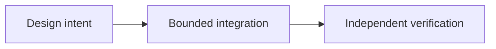

# OpenSettlement: Coordinating Different Payment Rails

*Editorial draft. Season 4. Not approved for publication.*

## The question

A

## Design direction

U

## Evidence before claims

U

## Conceptual flow

Text equivalent: the proposal progresses from design intent to a bounded integration and then to independent verification. This is not an implementation status report.

*Pending: source-of-truth verification, specific citations, editorial review and owner approval.*

## Inspected boundary, not production certification

The registry names different rails with different readiness and authority; not all are production eligible. **Failure:** confusing a documented design with deployed behavior. Exact-head integration and runtime verification remain required.

- [escrow-providers.ts](https://github.com/sails-protocol/Sails-Protocol/blob/be6d3bc2ddfc384cfafa4276e01b8aacc096d421/src/modules/open-settlement/escrow-providers.ts)
