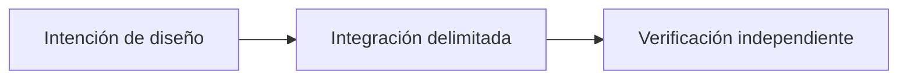

# OpenSettlement: coordinar distintos medios de pago

*Borrador editorial. Temporada 4. Publicación no aprobada.*

## La cuestión

B

## Dirección de diseño

a

## Evidencia antes de las afirmaciones

a

## Flujo conceptual

Equivalente textual: la propuesta pasa de la intención de diseño a una integración delimitada y luego a la verificación independiente. No es un informe de implementación.

*Pendiente: verificación en fuentes técnicas, citas específicas, revisión editorial y aprobación del responsable.*

## Límite examinado en el código

El registro enumera redes con distinta autoridad y madurez; no todas son aptas para producción. Un límite documentado no es prueba de ejecución del HEAD actual; hay que probar el fallo contra estado duradero antes de afirmar madurez.

- [escrow-providers.ts](https://github.com/sails-protocol/Sails-Protocol/blob/be6d3bc2ddfc384cfafa4276e01b8aacc096d421/src/modules/open-settlement/escrow-providers.ts)
