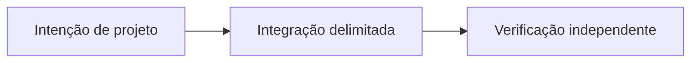

# OpenSettlement: coordenando diferentes meios de pagamento

*Rascunho editorial. Temporada 4. Publicação não aprovada.*

## A questão

 

## Direção de projeto

m

## Evidência antes das afirmações

n

## Fluxo conceitual

Equivalente textual: a proposta vai da intenção de projeto para uma integração delimitada e depois para verificação independente. Não é um relatório de implementação.

*Pendente: verificação na fonte técnica, citações específicas, revisão editorial e aprovação do responsável.*
