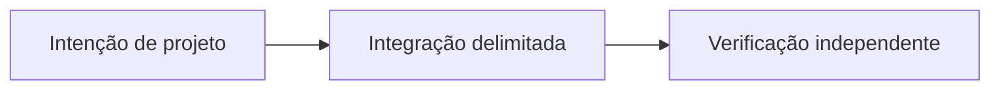

# OpenSettlement: coordenando diferentes meios de pagamento

*Rascunho editorial. Temporada 4. Publicação não aprovada.*

## A pergunta

Um mesmo fluxo pode liquidar Bitcoin multisig, um pagamento Lightning em retenção e um token EVM com as mesmas regras de finalidade? Não. Cada rede tem autoridade externa e janelas de falha próprias.

## Decisão e fronteira

O registro examinado inclui caminhos MULTISIG, LIGHTNING_HODL, WDK_USDT_EVM e SAFE_GUARD_EVM. A prontidão não é equivalente: o caminho WDK_USDT_EVM com custódia no servidor não está elegível para produção, e SAFE_GUARD_EVM exige prova ao vivo com RPC financiado e bundler. A evidência registrada de recuperação e reconciliação cobre cenários MULTISIG específicos, não todas as redes. A coordenação OpenSettlement precisa preservar essas diferenças, não reduzi-las a um único estado Liquidado.

## Falha e evidência

Um provedor expira após transmitir uma operação. Repetir o efeito econômico sem reconciliação pode duplicá-lo; assumir falha pode deixar a negociação travada. A evidência de recuperação vale para a rede testada. Uma garantia entre redes exige recibos independentes, testes de reinício no HEAD exato e verificação do vínculo com o destino.

## Próxima pergunta

Qual rede demonstra finalidade, recuperação e vínculo com o destino diante de uma falha real do provedor?

## Fluxo conceitual

Equivalente textual: a proposta vai da intenção de projeto para uma integração delimitada e depois para verificação independente. Não é um relatório de implementação.

*Pendente: verificação na fonte técnica, citações específicas, revisão editorial e aprovação do responsável.*

## Fronteira examinada, não certificação de produção

O registro descreve redes com autoridades e prontidão diferentes; nem todas estão elegíveis para produção. **Falha:** confundir design documentado com comportamento implantado. Ainda são necessários testes de integração e execução no HEAD exato.

- [escrow-providers.ts](https://github.com/sails-protocol/Sails-Protocol/blob/be6d3bc2ddfc384cfafa4276e01b8aacc096d421/src/modules/open-settlement/escrow-providers.ts)
