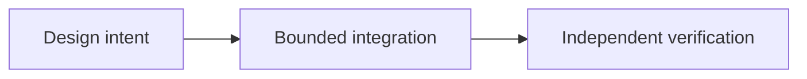

# OpenLiquidity: Connecting Fragmented P2P Markets

*Editorial draft. Season 4. Not approved for publication.*

## The question

T

## Design direction

D

## Evidence before claims

D

## Conceptual flow

Text equivalent: the proposal progresses from design intent to a bounded integration and then to independent verification. This is not an implementation status report.

*Pending: source-of-truth verification, specific citations, editorial review and owner approval.*
