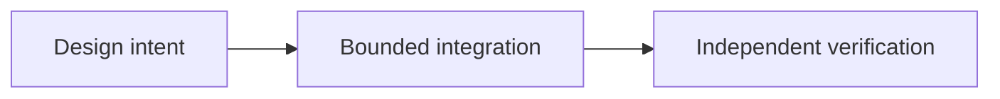

# OpenLiquidity: Connecting Fragmented P2P Markets

*Editorial draft. Season 4. Not approved for publication.*

## The question

Does showing offers from multiple venues mean liquidity is shared? No.

## Decision and boundary

OpenLiquidity is a coordination direction. Discovery and routing must respect asset, network, price, availability and permissions. Provider-substitution evidence covers selected invariants, not an operational cross-market book.

## Failure and evidence

A visible offer may be inaccessible to a wallet due to permissions or payment method. Do not advertise executable depth from visibility; require live counterparties and cross-client tests.

## Conceptual flow

Text equivalent: the proposal progresses from design intent to a bounded integration and then to independent verification. This is not an implementation status report.

*Pending: source-of-truth verification, specific citations, editorial review and owner approval.*

## Failure scenario: visible depth cannot be executed

A marketplace aggregates two offers denominated in the same asset. One offer requires a payment method unavailable to the buyer; the other is stale after its maker withdraws. The interface adds their amounts and displays deep shared liquidity. Yet neither offer can be executed by that user at the displayed price. Discovery has been mistaken for an executable market.

**Trade-off:** aggregating every visible offer increases apparent breadth but risks misleading price and availability signals. A narrower, permission-aware view can show less depth while remaining more useful. Neither choice establishes atomic routing or guaranteed settlement across providers.

**Next test:** remove maker availability between discovery and acceptance, change the buyer's payment permissions and replay a stale quote. Measure explicit rejection and reconciliation rather than treating offer visibility as execution. Provider-substitution invariance evidence is scoped; it is not proof of a live universal order book.

## Source-backed scope

Selected provider substitution properties do not prove shared cross-rail liquidity. **Failure:** treating a source-level design or API as universal production readiness. Exact-head tests and approval remain outstanding.

- [PROVIDER_SUBSTITUTION_INVARIANCE_EVIDENCE.md](https://github.com/sails-protocol/Sails-Protocol/blob/be6d3bc2ddfc384cfafa4276e01b8aacc096d421/docs/PROVIDER_SUBSTITUTION_INVARIANCE_EVIDENCE.md)
