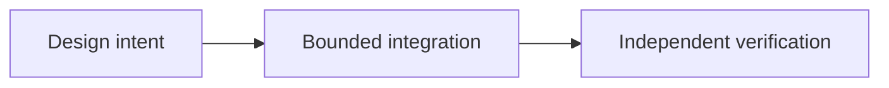

# OpenLiquidity: Connecting Fragmented P2P Markets

*Editorial draft. Season 4. Not approved for publication.*

## The question

T

## Design direction

D

## Evidence before claims

D

## Conceptual flow

Text equivalent: the proposal progresses from design intent to a bounded integration and then to independent verification. This is not an implementation status report.

*Pending: source-of-truth verification, specific citations, editorial review and owner approval.*

## Source-backed scope

Selected provider substitution properties do not prove shared cross-rail liquidity. **Failure:** treating a source-level design or API as universal production readiness. Exact-head tests and approval remain outstanding.

- [PROVIDER_SUBSTITUTION_INVARIANCE_EVIDENCE.md](https://github.com/sails-protocol/Sails-Protocol/blob/be6d3bc2ddfc384cfafa4276e01b8aacc096d421/docs/PROVIDER_SUBSTITUTION_INVARIANCE_EVIDENCE.md)
