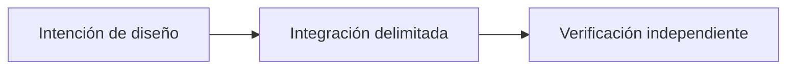

# OpenLiquidity: conectar mercados P2P fragmentados

*Borrador editorial. Temporada 4. Publicación no aprobada.*

## La cuestión

o

## Dirección de diseño

a

## Evidencia antes de las afirmaciones

s

## Flujo conceptual

Equivalente textual: la propuesta pasa de la intención de diseño a una integración delimitada y luego a la verificación independiente. No es un informe de implementación.

*Pendiente: verificación en fuentes técnicas, citas específicas, revisión editorial y aprobación del responsable.*
