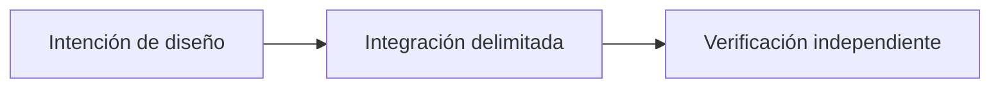

# OpenLiquidity: conectar mercados P2P fragmentados

*Borrador editorial. Temporada 4. Publicación no aprobada.*

## La pregunta

¿Mostrar ofertas de varios mercados significa liquidez compartida? No.

## Decisión y límite

OpenLiquidity es una dirección de coordinación. Descubrimiento y enrutamiento deben respetar activo, red, precio, disponibilidad y permisos. La evidencia de sustitución cubre invariantes seleccionadas, no un libro operativo entre mercados.

## Fallo y evidencia

Una oferta visible puede ser inaccesible por permisos o medio de pago. No anunciar profundidad ejecutable solo por visibilidad; hacen falta contrapartes reales y pruebas entre clientes.

## Flujo conceptual

Equivalente textual: la propuesta pasa de la intención de diseño a una integración delimitada y luego a la verificación independiente. No es un informe de implementación.

*Pendiente: verificación en fuentes técnicas, citas específicas, revisión editorial y aprobación del responsable.*

## Escenario de fallo: la profundidad visible no es ejecutable

Un mercado agrega dos ofertas del mismo activo. Una exige un medio de pago no disponible para el comprador; la otra quedó obsoleta cuando su creador la retiró. La interfaz suma los importes y muestra gran liquidez compartida. Sin embargo, ninguna oferta puede ejecutarse por ese usuario al precio mostrado. Se confundió descubrimiento con mercado ejecutable.

**Alternativa:** agregar todas las ofertas visibles aumenta la amplitud aparente, pero puede inducir a error sobre precio y disponibilidad. Una vista más limitada, filtrada por permisos, puede mostrar menos profundidad y ser más útil. Ninguna opción demuestra enrutamiento atómico ni liquidación garantizada entre proveedores.

**Siguiente prueba:** retirar la disponibilidad del creador entre descubrimiento y aceptación, cambiar permisos de pago del comprador y repetir una cotización caducada. Medir rechazo explícito y reconciliación, no tratar visibilidad como ejecución. La evidencia de sustitución de proveedores tiene alcance limitado y no demuestra un libro universal de ofertas operativo.

## Alcance respaldado por fuente

Propiedades seleccionadas de sustitución no prueban liquidez compartida entre redes. **Fallo:** tratar diseño o API inspeccionada como preparación universal de producción. Faltan pruebas del HEAD exacto y aprobación.

- [PROVIDER_SUBSTITUTION_INVARIANCE_EVIDENCE.md](https://github.com/sails-protocol/Sails-Protocol/blob/be6d3bc2ddfc384cfafa4276e01b8aacc096d421/docs/PROVIDER_SUBSTITUTION_INVARIANCE_EVIDENCE.md)
