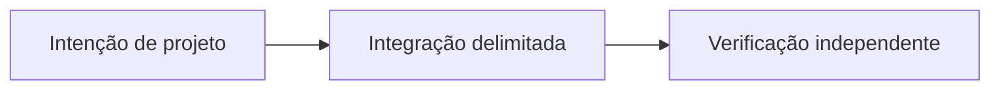

# OpenLiquidity: conectando mercados P2P fragmentados

*Rascunho editorial. Temporada 4. Publicação não aprovada.*

## A pergunta

Mostrar ofertas de vários mercados significa liquidez compartilhada? Não.

## Decisão e fronteira

OpenLiquidity é uma direção de coordenação. Descoberta e roteamento precisam respeitar ativo, rede, preço, disponibilidade e permissões. A evidência de substituição cobre invariantes selecionados, não um livro operacional entre mercados.

## Falha e evidência

Uma oferta visível pode ser inacessível à carteira por permissões ou meio de pagamento. Não anunciar profundidade executável só pela visibilidade; exigir contrapartes reais e testes entre clientes.

## Fluxo conceitual

Equivalente textual: a proposta vai da intenção de projeto para uma integração delimitada e depois para verificação independente. Não é um relatório de implementação.

*Pendente: verificação na fonte técnica, citações específicas, revisão editorial e aprovação do responsável.*

## Cenário de falha: profundidade visível não é executável

Um mercado agrega duas ofertas do mesmo ativo. Uma exige meio de pagamento indisponível ao comprador; a outra ficou desatualizada depois da retirada pelo anunciante. A interface soma os valores e apresenta grande liquidez compartilhada. Entretanto, nenhuma oferta pode ser executada por aquele usuário ao preço exibido. Descoberta foi confundida com mercado executável.

**Alternativa:** agregar toda oferta visível aumenta a amplitude aparente, mas pode enganar sobre preço e disponibilidade. Uma visão menor, filtrada por permissões, pode exibir menos profundidade e ser mais útil. Nenhuma das opções comprova roteamento atômico ou liquidação garantida entre provedores.

**Próximo teste:** retirar a disponibilidade do anunciante entre descoberta e aceite, alterar permissões de pagamento do comprador e repetir uma cotação vencida. Medir rejeição explícita e reconciliação, não tratar visibilidade como execução. A evidência de substituição de provedores tem escopo limitado e não prova um livro universal de ofertas em operação.

## Escopo fundamentado em fonte

Propriedades selecionadas de substituição não comprovam liquidez compartilhada entre redes. **Falha:** tratar design ou API examinada como prontidão universal de produção. Testes no HEAD exato e aprovação seguem pendentes.

- [PROVIDER_SUBSTITUTION_INVARIANCE_EVIDENCE.md](https://github.com/sails-protocol/Sails-Protocol/blob/be6d3bc2ddfc384cfafa4276e01b8aacc096d421/docs/PROVIDER_SUBSTITUTION_INVARIANCE_EVIDENCE.md)
