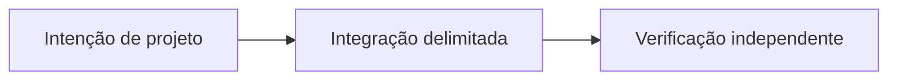

# OpenLiquidity: conectando mercados P2P fragmentados

*Rascunho editorial. Temporada 4. Publicação não aprovada.*

## A pergunta

Mostrar ofertas de vários mercados significa liquidez compartilhada? Não.

## Decisão e fronteira

OpenLiquidity é uma direção de coordenação. Descoberta e roteamento precisam respeitar ativo, rede, preço, disponibilidade e permissões. A evidência de substituição cobre invariantes selecionados, não um livro operacional entre mercados.

## Falha e evidência

Uma oferta visível pode ser inacessível à carteira por permissões ou meio de pagamento. Não anunciar profundidade executável só pela visibilidade; exigir contrapartes reais e testes entre clientes.

## Fluxo conceitual

Equivalente textual: a proposta vai da intenção de projeto para uma integração delimitada e depois para verificação independente. Não é um relatório de implementação.

*Pendente: verificação na fonte técnica, citações específicas, revisão editorial e aprovação do responsável.*

## Escopo fundamentado em fonte

Propriedades selecionadas de substituição não comprovam liquidez compartilhada entre redes. **Falha:** tratar design ou API examinada como prontidão universal de produção. Testes no HEAD exato e aprovação seguem pendentes.

- [PROVIDER_SUBSTITUTION_INVARIANCE_EVIDENCE.md](https://github.com/sails-protocol/Sails-Protocol/blob/be6d3bc2ddfc384cfafa4276e01b8aacc096d421/docs/PROVIDER_SUBSTITUTION_INVARIANCE_EVIDENCE.md)
