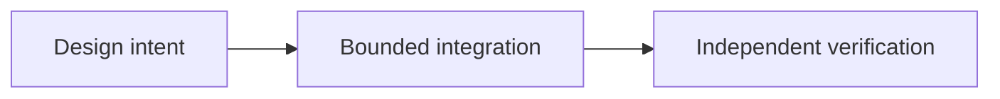

# OpenAgents: coordinación económica para agentes de IA

*Editorial draft / rascunho editorial / borrador editorial. Season 4. Not approved for publication.*

## La cuestión

Un agente de IA puede sugerir una operación o preparar una instrucción. Eso no significa que deba tener autoridad ilimitada para mover fondos, aprobar disputas o cambiar estados económicos.

## Dirección de diseño

OpenAgents explora cómo agentes de software podrían interactuar con flujos Sails bajo permisos delimitados, límites de gasto, aprobaciones humanas explícitas e historial auditable. El sistema debe distinguir recomendaciones de instrucciones firmadas y resultados ejecutados. Las salidas de herramientas y textos generados por modelos no prueban pagos.

## Evidencia antes de las afirmaciones

Esto es arquitectura exploratoria, no un anuncio de operaciones autónomas en producción. Antes de permitir actuar a un agente, necesitamos revocación, defensas contra repetición, pruebas adversariales y responsabilidad clara por los fallos.

## Flujo conceptual

Equivalente textual: la intención de diseño pasa a una integración delimitada y a verificación independiente. No demuestra un despliegue.

*Source verification, references, editorial review and owner approval pending.*
