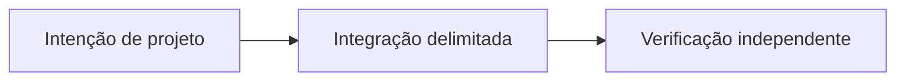

# OpenAgents: coordenação econômica para agentes de IA

*Rascunho editorial. Temporada 4. Publicação não aprovada.*

## A pergunta

Um agente de IA pode negociar sem virar dono independente dos fundos?

## Decisão e fronteira

O RFC trata agentes como delegados, não principais econômicos independentes. OpenAgents precisa de escopo, revogação, limites e autoridade responsável; a saída do modelo não autoriza liquidação.

## Falha e evidência

Um agente pode propor negociação após o mandato expirar. O nó deve rejeitar antes de efeitos econômicos; comprovar autorização no commit exato. Não há garantia de agente autônomo implantado.

## Fluxo conceitual

Equivalente textual: a proposta vai da intenção de projeto para uma integração delimitada e depois para verificação independente. Não é um relatório de implementação.

*Pendente: verificação na fonte técnica, citações específicas, revisão editorial e aprovação do responsável.*

## Cenário de falha: agente ultrapassa mandato revogado

Uma pessoa delega a um agente permissão para propor negociações abaixo de certo limite. O agente prepara a proposta, mas a pessoa revoga o mandato antes do envio. Uma mensagem atrasada chega depois da revogação e solicita liberação de escrow, ou altera o destino mantendo assinatura válida. Saída de modelo e posse de chave não substituem autorização atual do participante.

**Alternativa:** permissões permanentes amplas reduzem etapas, mas concentram risco econômico. Mandatos delimitados, expiração, confirmação explícita e verificação de revogação exigem mais passos e tornam a responsabilidade testável. O principal continua sendo o ator econômico.

**Próximo teste:** disputar a corrida entre revogação e envio, exceder limite de valor delegado, repetir solicitação assinada e alterar seu destino. Verificar rejeição no HEAD exato antes de mudança durável de estado ou efeito econômico externo. O RFC de participantes documenta papéis, não comprova agente autônomo de negociação implantado.

## Fronteira examinada no código

Um agente delegado não adquire autoridade econômica independente. Fronteira documentada não é prova de execução no HEAD atual; testar a falha contra estado durável antes de afirmar prontidão.

- [RFC-001-participant-model.md](https://github.com/sails-protocol/Sails-Protocol/blob/be6d3bc2ddfc384cfafa4276e01b8aacc096d421/docs/rfcs/RFC-001-participant-model.md)
