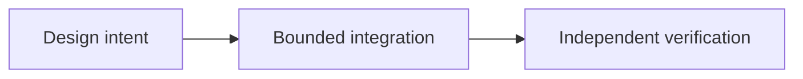

# OpenFinance and the Future of P2P Applications

*Editorial draft / rascunho editorial / borrador editorial. Season 4. Not approved for publication.*

## The question

A user may want to trade, swap, borrow or interact with a prediction market from one interface. The convenience is real, but so is the risk of blurring independent providers and their obligations.

## Design direction

OpenFinance is a future-facing module concept, not a promise that all financial services will become native to Sails Protocol. A reference application can integrate external providers while making contracts, permissions, fees, risk disclosures and custody boundaries visible.

## Evidence before claims

The useful question is not how many services fit on one screen. It is whether a user can understand who performs each action and what happens when something fails. Those boundaries will determine which integrations deserve to ship.

## Conceptual flow

Text equivalent: design intent progresses to a bounded integration and independent verification. This is not proof of deployment.

*Source verification, references, editorial review and owner approval pending.*
