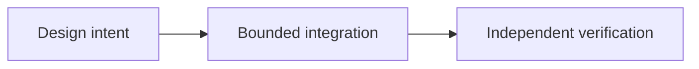

# OpenFinance y el futuro de las aplicaciones P2P

*Editorial draft / rascunho editorial / borrador editorial. Season 4. Not approved for publication.*

## La cuestión

Una persona puede querer negociar, intercambiar activos, pedir préstamos o acceder a mercados de predicción desde una sola interfaz. La comodidad es real, pero también el riesgo de confundir proveedores independientes y sus obligaciones.

## Dirección de diseño

OpenFinance es un concepto de módulo futuro, no una promesa de que todos los servicios financieros serán nativos de Sails Protocol. Una aplicación de referencia puede integrar proveedores externos y mostrar contratos, permisos, tarifas, riesgos y límites de custodia.

## Evidencia antes de las afirmaciones

La pregunta útil no es cuántos servicios caben en una pantalla. Es si el usuario entiende quién realiza cada acción y qué ocurre cuando algo falla. Esos límites determinarán qué integraciones merecen publicarse.

## Flujo conceptual

Equivalente textual: la intención de diseño pasa a una integración delimitada y a verificación independiente. No demuestra un despliegue.

*Pendientes: verificación de fuentes, referencias específicas, revisión editorial y aprobación de la persona responsable.*

## Escenario de fallo: una interfaz oculta dos contratos independientes

Una persona aprueba un intercambio y una solicitud de préstamo en la misma pantalla. El intercambio se liquida, pero el proveedor del préstamo rechaza la solicitud después de recibir información preliminar. Si la interfaz marca toda la secuencia como completada, la persona puede interpretar mal exposición, comisiones o custodia. Una sola aplicación no crea una sola autoridad jurídica o económica.

**Alternativa:** un panel unificado es cómodo, pero puede ocultar identidad del proveedor, riesgos y responsabilidades de recuperación. Avisos por proveedor, confirmaciones independientes y estados separados de pendiente y fallido añaden pasos, pero preservan el consentimiento informado.

**Siguiente prueba:** simular el éxito de un servicio externo mientras otro falla o retrasa su respuesta. Comprobar estados, permisos, comisiones e información de custodia específicos de cada proveedor, sin autorizar silenciosamente una segunda acción en reintentos. Es una prueba propuesta, no evidencia de OpenFinance ni de servicios externos disponibles en producción.

## Alcance respaldado por fuente

OpenFinance es un módulo propuesto, no un servicio financiero demostrado en producción. **Fallo:** tratar diseño o API inspeccionada como preparación universal de producción. Faltan pruebas del HEAD exacto y aprobación.

- [PROTOCOL_INVARIANTS.md](https://github.com/sails-protocol/Sails-Protocol/blob/be6d3bc2ddfc384cfafa4276e01b8aacc096d421/docs/PROTOCOL_INVARIANTS.md)
