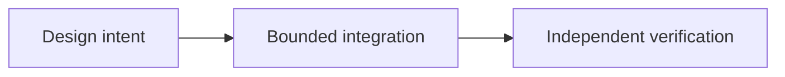

# OpenFinance e o futuro das aplicações P2P

*Editorial draft / rascunho editorial / borrador editorial. Season 4. Not approved for publication.*

## A questão

Uma pessoa pode querer negociar, trocar ativos, tomar empréstimos ou acessar mercados de previsão numa única interface. A conveniência é real, mas também é o risco de confundir provedores independentes e suas obrigações.

## Direção de projeto

OpenFinance é um conceito de módulo futuro, não uma promessa de que todos os serviços financeiros serão nativos do Sails Protocol. Uma aplicação de referência pode integrar provedores externos, deixando visíveis contratos, permissões, taxas, riscos e limites de custódia.

## Evidência antes das afirmações

A pergunta útil não é quantos serviços cabem numa tela. É se o usuário entende quem executa cada ação e o que acontece quando algo falha. Esses limites determinarão quais integrações merecem chegar ao público.

## Fluxo conceitual

Equivalente textual: a intenção de projeto passa por uma integração delimitada e verificação independente. Não comprova implantação.

*Source verification, references, editorial review and owner approval pending.*

## Escopo fundamentado em fonte

OpenFinance é módulo proposto, não serviço financeiro comprovado em produção. **Falha:** tratar design ou API examinada como prontidão universal de produção. Testes no HEAD exato e aprovação seguem pendentes.

- [PROTOCOL_INVARIANTS.md](https://github.com/sails-protocol/Sails-Protocol/blob/be6d3bc2ddfc384cfafa4276e01b8aacc096d421/docs/PROTOCOL_INVARIANTS.md)
