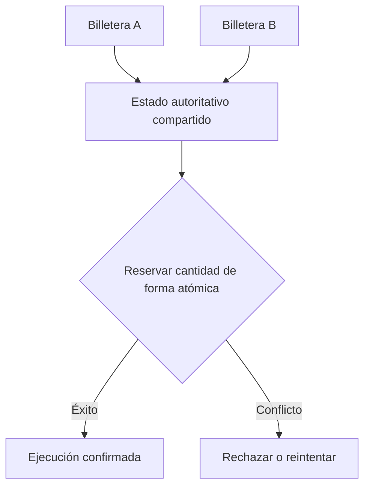

## El cambio

Una billetera, una terminal web y una aplicación de terceros no deberían necesitar mundos económicos separados. Sails Market se plantea como implementación de referencia para mostrar oportunidades desde una infraestructura compartida de coordinación. Eso no prueba la existencia de un libro universal de órdenes en producción ni liquidez propia de Sails. Las salas privadas pueden limitar el acceso sin cambiar la autoridad económica subyacente.

<!-- truncate -->

## La respuesta arquitectónica

Imaginemos dos interfaces que muestran la última unidad disponible de una oferta. Una persona acepta primero. La otra debe recibir un rechazo autorizado o una cotización actualizada, nunca una ejecución ficticia. Descubrimiento, elegibilidad, reserva y liquidación son etapas diferentes. Las pruebas de concurrencia y recuperación son indispensables antes de afirmar interoperabilidad bajo carga real.

## Una oferta, dos pantallas, una ejecución disponible

Imaginemos una oferta visible en Sails Market y en una billetera externa. Ambas muestran la última cantidad disponible. Una persona la acepta, pero la otra pantalla aún no se ha actualizado. Descubrimiento compartido no significa liquidez reservada. La aceptación debe comprobar el estado autorizado, los permisos, el método de pago y la vigencia de la cotización. Una sala privada puede cambiar quién puede ver o aceptar una oferta sin crear otra realidad económica. Ese es el objetivo arquitectónico, no una afirmación de que la concurrencia entre aplicaciones ya superó pruebas de producción. La prueba necesaria es una carrera en la que solo una aceptación válida tenga éxito y el otro cliente reciba un resultado recuperable.

## La interoperabilidad necesita una fuente de verdad

Si una interfaz muestra una operación como completada y otra como abierta, el mercado compartido ha fallado en su promesa básica. Las ofertas necesitan identificadores estables, vencimiento explícito, condiciones económicas consistentes y transiciones de estado resistentes a reintentos. Las salas privadas pueden limitar quién ve una oferta, pero no deben cambiar silenciosamente las obligaciones de liquidación.

Una billetera debería poder abandonar una interfaz y continuar por otra sin perder las pruebas necesarias para entender su operación. Es una meta arquitectónica de Sails, no una afirmación de portabilidad ya verificada en producción.

## La competencia debería estar en la experiencia, no en la propiedad de la orden

Muchos productos financieros digitales mantienen ofertas, usuarios, historial y liquidez dentro del mismo sistema cerrado. Eso simplifica algunas decisiones centralizadas, pero dificulta la entrada de interfaces especializadas. Una cartera para comerciantes y una aplicación para consumidores podrían atender públicos distintos sin reconstruir toda la infraestructura de negociación.

La interoperabilidad exige disciplina. No significa que todas las interfaces puedan modificar la misma operación. Una orden necesita identidad, versiones, reglas de vigencia y autoridad definida. Una aplicación puede mostrar una oportunidad y otra solicitar su aceptación, pero la confirmación económica debe respetar una fuente de verdad verificable.

## ¿Qué ocurre cuando una interfaz pierde la conexión?

Imaginemos a un comerciante que acepta una oferta en Sails Market mientras una billetera móvil observa el mismo mercado. Se envía la solicitud, se corta la conexión y la interfaz no sabe si la operación quedó confirmada. Un reintento debe conservar la identidad de la operación; de lo contrario, otra pantalla podría crear una segunda obligación por error. La infraestructura debe devolver un resultado duradero o un estado explícitamente pendiente de conciliación. Un mensaje de éxito en pantalla no demuestra liquidación.

La implementación de referencia debe separar cuatro conceptos: *oferta* es una oportunidad bajo condiciones definidas; *aceptación* es una solicitud de compromiso; *reserva* es una asignación temporal de disponibilidad; y *liquidación* es un evento económico distinto. Una interfaz puede mostrar los cuatro, pero no debería condensarlos en un único estado optimista. En salas privadas, los permisos deben comprobarse en la transición autorizada, no solo al cargar la página.

## ¿Cómo demostrar la promesa?

Antes de llamar compartido a un mercado en producción, hace falta una matriz reproducible: dos clientes compitiendo por la última unidad; un reintento tras un tiempo de espera; reconexión después de reiniciar el servidor; revocación del acceso a una sala entre descubrimiento y aceptación; y dos interfaces consultando el mismo resultado duradero. El resultado esperado es una única decisión económica, identificadores coherentes y una explicación rastreable para cada rechazo o estado pendiente. Son criterios de aceptación, no afirmaciones de que Sails ya los haya superado en producción.

## Límite de la evidencia

El estado económico compartido es el objetivo de diseño, no una prueba de interoperabilidad entre aplicaciones en producción.

## Una oferta, múltiples interfaces

Dos aplicaciones pueden mostrar la misma oferta, pero no confirmar dos ejecuciones sobre la misma cantidad disponible.

