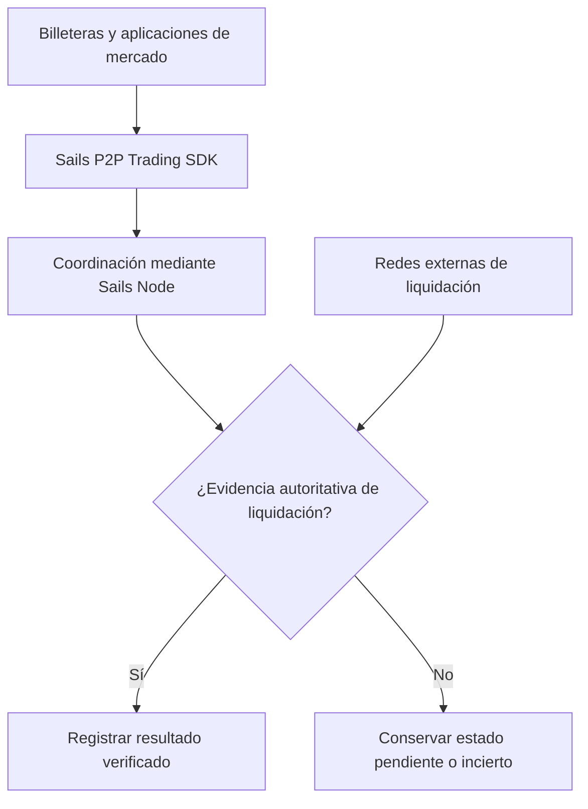

## El cambio

La gran idea no es otra exchange. Es un Economic Coordination Protocol for Building Interoperable P2P Financial Marketplaces. En este modelo, la billetera responde por las claves y autorizaciones del usuario; la aplicación presenta opciones; el SDK comunica acciones; el nodo coordina estados; y los sistemas externos aportan evidencia de pago y liquidación. Estos límites solo importan si se cumplen, no si aparecen en un diagrama.

<!-- truncate -->

## La respuesta arquitectónica

Para el primer módulo, P2P Trading SDK, la credibilidad depende de pruebas: idempotencia entre reintentos, control de concurrencia, recuperación tras reinicios, autenticación de participantes, límites de pruebas y autoridad explícita para disputas. Los demás módulos son parte del roadmap hasta que su implementación y pruebas permitan afirmaciones más fuertes. La meta es interoperabilidad económica sin convertir a un actor en custodio o controlador obligatorio.

## La coordinación debe resistir los desacuerdos

Un protocolo de coordinación económica se pone a prueba cuando los participantes discrepan, los mensajes llegan dos veces, un proceso se reinicia o un proveedor de pagos devuelve un resultado ambiguo. Se necesitan autoridad explícita de los participantes, transiciones idempotentes, procedencia de las pruebas y reglas de recuperación; una API atractiva no basta. También importa reconocer lo que el protocolo no puede decidir: un estado en la base de datos no crea un pago externo y un coordinador no convierte una afirmación sin pruebas en liquidación. El primer producto concreto es el P2P Trading SDK. Los demás módulos siguen en la hoja de ruta; cualquier afirmación de funcionamiento real requiere implementación y pruebas reproducibles. La interoperabilidad se consigue mediante reglas compatibles y comportamiento reproducible, no por una marca.

## La coordinación económica es un problema de corrección

Demostrar una interfaz que empareja ofertas es sencillo. Coordinar correctamente es más difícil: las operaciones concurrentes no pueden comprometer la misma capacidad dos veces, un proceso reiniciado no puede duplicar la liquidación y las pruebas no deben sobrescribirse en silencio. Si una cuenta de pago o proveedor externo es la autoridad sobre un hecho, el nodo no puede inventarlo para completar el flujo.

El valor del protocolo depende de imponer estos límites mediante persistencia, pruebas con dependencias reales y evidencias reproducibles. Hasta revisar la implementación en un commit exacto, el texto debe separar metas arquitectónicas de propiedades verificadas en ejecución.

## Coordinar no es lo mismo que mover activos

Un protocolo de coordinación económica organiza compromisos, estados y evidencias entre participantes que usan diferentes carteras, redes y proveedores. No significa que el protocolo custodie dinero ni que pueda garantizar el comportamiento de terceros. Debe definir qué acontecimientos son válidos, cómo se observan y cuándo una transición puede considerarse terminada.

Una operación P2P puede atravesar varias fronteras de confianza: identidad, publicación de ofertas, reserva de capacidad, prueba de pago, disputas y liberación de garantías. Cada transición necesita una autoridad definida y reglas para eventos duplicados o fuera de orden.

## La prueba del reinicio

Un sistema parece fiable hasta que el proceso se detiene entre registrar una decisión y publicar el resultado. Al reiniciar puede repetir la operación. Si la repetición genera un segundo cobro, una segunda liberación o un cierre contradictorio, la coordinación económica no es sólida. Por eso hacen falta transacciones atómicas cuando corresponda, idempotencia, conciliación y pruebas realistas de concurrencia y recuperación.

En Sails, estos términos no deben presentarse como certificados de preparación para producción. Son propiedades que requieren evidencia en el código, una base de datos real y las integraciones pertinentes. Un artículo puede explicar el diseño; las pruebas reproducibles deben demostrar su implementación.

## Una aplicación no tiene que ser dueña del mercado

Una aplicación de referencia como Sails Market puede demostrar el uso del protocolo sin monopolizar las oportunidades coordinadas. Satsails Wallet y carteras externas podrían construir experiencias distintas sobre infraestructura compartida cuando existan realmente los módulos e integraciones necesarios. Es un objetivo arquitectónico, no un lanzamiento confirmado.

El modelo funciona si las interfaces compiten mientras las reglas de validez siguen siendo compartidas y verificables. De lo contrario, la interoperabilidad se reduce a pantallas que muestran versiones incompatibles de la realidad.

## El límite entre coordinación y liquidación

La coordinación describe una intención acordada; la liquidación establece qué ocurrió realmente con el valor. No se puede inferir un resultado duradero de la eliminación de una operación pendiente ni de un timeout. El sistema debe conservar la incertidumbre hasta obtener evidencia autorizada. Es un requisito de diseño, no una afirmación de que la implementación actual superó sus controles de producción.

## Límite de la evidencia

El modelo de coordinación descrito aquí aún requiere pruebas de estado duradero, reintentos y proveedores antes de afirmar capacidad en producción.

## Arquitectura de un vistazo

Este diagrama conceptual separa interfaces, coordinación y liquidación externa. No implica que todas las integraciones estén disponibles.

