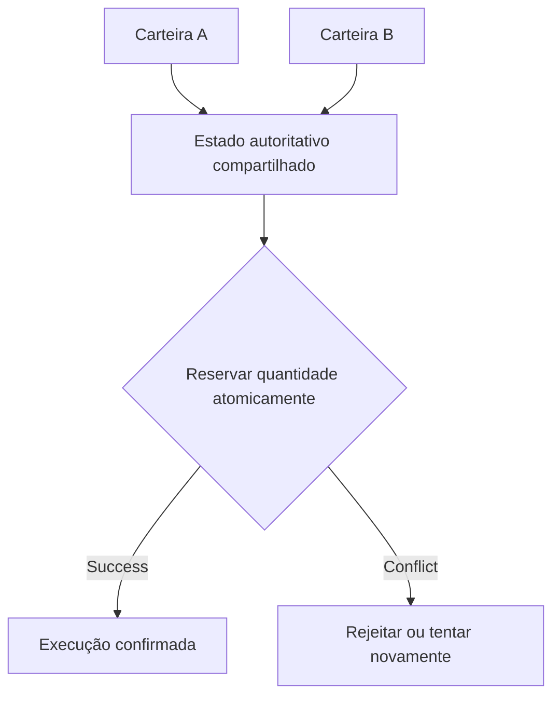

## A mudança

Uma carteira, um terminal web e uma aplicação de terceiros não deveriam precisar criar mundos econômicos isolados. O Sails Market é concebido como implementação de referência capaz de apresentar oportunidades provenientes de infraestrutura compartilhada de coordenação. Isso não significa que exista hoje um livro universal de ordens em produção nem liquidez própria do Sails. Salas privadas podem restringir acesso sem modificar a autoridade econômica subjacente.

<!-- truncate -->

## A resposta arquitetural

Imagine duas interfaces exibindo a última unidade disponível de uma oferta. Um usuário aceita primeiro. O outro precisa receber uma rejeição autoritativa ou cotação atualizada, não uma execução fictícia. Descoberta, elegibilidade, reserva e liquidação são etapas distintas. Provas de concorrência e recuperação são pré-requisitos para afirmar interoperabilidade sob carga real.

## Uma oferta, duas telas, uma execução disponível

Imagine uma oferta visível no Sails Market e em uma carteira de terceiros. Ambas exibem a última quantidade disponível. Uma pessoa aceita, mas a outra tela ainda não atualizou. Descoberta compartilhada não pode ser confundida com liquidez reservada. O aceite precisa consultar o estado autoritativo, as permissões, o meio de pagamento e a validade da cotação. Uma sala privada pode alterar quem está autorizado a ver ou aceitar uma oferta sem criar outra realidade econômica. Esse é o objetivo arquitetural, não uma afirmação de que a concorrência entre aplicações já passou em testes de produção. A prova necessária é um teste de corrida no qual apenas um aceite válido tem sucesso e o outro cliente recebe um resultado recuperável.

## Interoperabilidade exige uma fonte de verdade

Se uma interface mostra a negociação como concluída e outra como aberta, o mercado compartilhado falhou na promessa mais básica. Ofertas precisam de identificadores estáveis, prazo de validade, condições econômicas consistentes e transições de estado que resistam a tentativas repetidas. Salas privadas podem limitar quem vê uma oferta, mas não podem alterar silenciosamente as obrigações de liquidação.

Uma carteira deveria poder sair de uma interface e continuar por outra sem perder as evidências necessárias para compreender a operação. Essa é uma meta arquitetural do Sails, não uma afirmação de portabilidade já comprovada em produção.

## A competição deveria acontecer na experiência, não na posse da ordem

Hoje, muitos produtos financeiros digitais tentam manter a oferta, o usuário, o histórico e a liquidez dentro do mesmo jardim fechado. Isso facilita decisões centralizadas, mas dificulta a entrada de interfaces especializadas. Uma carteira voltada a comerciantes e um aplicativo para pessoas físicas poderiam atender públicos diferentes sem precisar reconstruir toda a infraestrutura de negociação.

Essa visão exige cuidado: interoperabilidade não significa que todas as interfaces possam modificar a mesma negociação. Uma ordem deve ter identidade, versão, regras de validade e autoridade bem definidas. Uma aplicação pode apresentar uma oportunidade; outra pode solicitar aceitação; a confirmação econômica precisa obedecer a uma fonte de verdade verificável.

## E quando uma interface perde a conexão?

Imagine um comerciante aceitando uma oferta pelo Sails Market enquanto uma carteira móvel acompanha o mesmo mercado. O pedido é enviado, a conexão cai e a interface não sabe se a operação foi confirmada. Uma nova tentativa precisa preservar a identidade da operação; caso contrário, outra tela pode criar uma segunda obrigação por engano. A infraestrutura deve devolver um resultado durável ou um estado explicitamente pendente de reconciliação. Uma mensagem de sucesso na tela não comprova liquidação.

A implementação de referência deve distinguir quatro conceitos: *oferta* é uma oportunidade sob condições definidas; *aceite* é uma solicitação de compromisso; *reserva* é uma reivindicação temporária sobre a disponibilidade; *liquidação* é um evento econômico separado. Uma interface pode exibir todos eles, mas não deve condensá-los em um único status otimista. Nas salas privadas, a permissão deve ser conferida na transição autoritativa, não apenas quando a página é carregada.

## Como comprovar a promessa?

Antes de chamar um mercado de compartilhado em produção, precisamos de uma matriz reproduzível: dois clientes disputando o último preenchimento de uma oferta; reenvio do aceite após timeout; reconexão depois do reinício do servidor; revogação de acesso à sala entre descoberta e aceite; e duas interfaces consultando o mesmo resultado durável. O resultado esperado é uma única decisão econômica, identificadores consistentes e uma explicação rastreável para cada rejeição ou pendência. São critérios de aceitação, não afirmações de que o Sails já os cumpriu em produção.

## Limite das evidências

Estado econômico compartilhado é o objetivo de arquitetura, não uma comprovação de interoperabilidade entre aplicações em produção.

## Uma oferta, múltiplas interfaces

Duas aplicações podem exibir a mesma oferta, mas não podem confirmar duas execuções sobre a mesma quantidade disponível.

