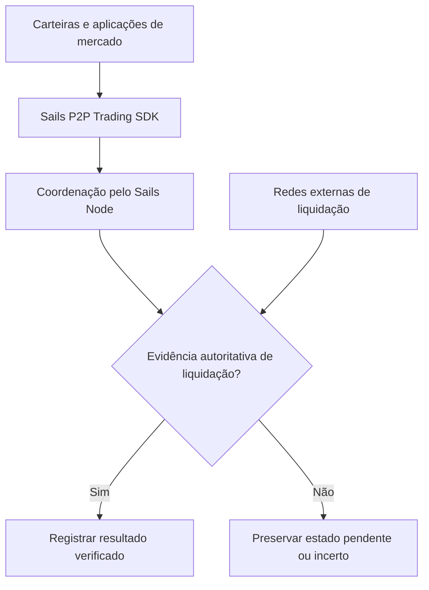

## A mudança

A grande ideia não é criar outra exchange. É um Economic Coordination Protocol for Building Interoperable P2P Financial Marketplaces. Nesse modelo, a carteira responde pelas chaves e aprovações do usuário; a aplicação apresenta escolhas; o SDK comunica ações; o nó coordena estados; e os meios externos fornecem evidências de pagamento e liquidação. Essas fronteiras só têm valor se forem aplicadas, não apenas desenhadas em diagramas.

<!-- truncate -->

## A resposta arquitetural

Para o primeiro módulo, o P2P Trading SDK, a credibilidade depende de evidências: idempotência após repetição, controle de concorrência, recuperação após reinício, autenticação de participantes, limites de provas e autoridade explícita para disputas. Os outros módulos permanecem no roadmap até que implementação e testes justifiquem afirmações mais fortes. O objetivo é interoperabilidade econômica sem transformar um único ator em custodiante ou controlador obrigatório.

## Coordenação precisa resistir a divergências

Um protocolo de coordenação econômica é testado quando participantes discordam, mensagens chegam duas vezes, um processo reinicia ou um provedor de pagamentos devolve um resultado ambíguo. São necessárias autoridade explícita dos participantes, transições idempotentes, procedência das evidências e regras de recuperação; uma API atraente de SDK não basta. Também importa reconhecer o que o protocolo não pode decidir: um status no banco não cria pagamento externo, e um coordenador não transforma uma alegação sem prova em liquidação. O primeiro foco concreto é o P2P Trading SDK. Os demais módulos continuam no roadmap; qualquer afirmação de funcionamento real exige implementação e testes reproduzíveis. Interoperabilidade é conquistada com regras compatíveis e comportamento reproduzível, não declarada pela marca.

## Coordenação econômica é um problema de correção

Demonstrar uma interface que combina ofertas é fácil. Coordenar corretamente é mais difícil: operações concorrentes não podem comprometer a mesma capacidade duas vezes, um processo reiniciado não pode duplicar o efeito da liquidação, e evidências não podem ser sobrescritas silenciosamente. Se uma conta de pagamento ou provedor externo é autoridade sobre um fato, o nó não pode inventá-lo apenas para concluir o fluxo.

O valor de longo prazo do protocolo depende de aplicar essas fronteiras com persistência, testes em dependências reais e evidências reproduzíveis. Até conferir a implementação num commit exato, o texto deve separar metas arquiteturais de propriedades demonstradas no runtime.

## Coordenação é diferente de movimentação de ativos

Um protocolo de coordenação econômica organiza compromissos, estados e evidências entre participantes que podem operar com carteiras, redes e provedores distintos. Isso não significa que o protocolo detenha o dinheiro nem que possa garantir o comportamento de serviços externos. Significa que ele precisa definir quais acontecimentos são válidos, como são observados e quando uma transição pode ser considerada concluída.

Uma negociação P2P pode atravessar várias fronteiras de confiança: identidade de participantes, publicação de oferta, reserva de capacidade, prova de pagamento, disputa e liberação de garantia. Cada transição precisa especificar quem tem autoridade e o que acontece se um evento chegar duplicado ou fora de ordem.

## O teste do reinício

Um sistema parece confiável até que o processo cai entre registrar uma decisão e publicar o resultado. Ao reiniciar, ele pode tentar novamente. Se a repetição criar uma segunda cobrança, uma segunda liberação ou uma conclusão contraditória, não houve coordenação econômica robusta. Por isso, a arquitetura precisa de transações atômicas onde aplicável, idempotência, reconciliação e testes reais de concorrência e recuperação.

No Sails, esses termos não devem aparecer como certificados de prontidão. Eles descrevem propriedades que exigem prova no código, em banco de dados real e em integrações relevantes. O artigo pode explicar a direção do projeto; somente evidências reproduzíveis podem atestar a implementação.

## A plataforma que não precisa ser dona do mercado

Uma aplicação de referência, como o Sails Market, pode demonstrar como usar o protocolo sem monopolizar as oportunidades que ele coordena. A Satsails Wallet e carteiras terceiras poderiam construir experiências distintas sobre a mesma infraestrutura quando os respectivos módulos e integrações estiverem efetivamente disponíveis. Esse é um objetivo arquitetural, não uma afirmação de lançamento concluído.

O êxito do modelo depende de uma distinção simples: o mercado pode ser aberto para interfaces concorrentes, mas suas regras de validade precisam ser compartilhadas e verificáveis. Sem isso, interoperabilidade vira apenas uma coleção de telas apontando para realidades incompatíveis.

## A fronteira entre coordenação e liquidação

Coordenação descreve uma intenção acordada; liquidação estabelece o que de fato ocorreu com o valor. Um resultado durável não pode ser inferido da exclusão de uma operação pendente nem de um timeout. O sistema deve preservar a incerteza até que uma evidência autorizada a resolva. Isso é requisito de projeto, não afirmação de que a implementação atual passou pelos gates de produção.

## Limite das evidências

O modelo de coordenação descrito aqui ainda exige provas de estado durável, repetição e provedores antes de alegações de produção.

## Arquitetura em uma visão

Este diagrama conceitual separa interfaces, coordenação e liquidação externa. Não significa que todas as integrações já estejam disponíveis.

